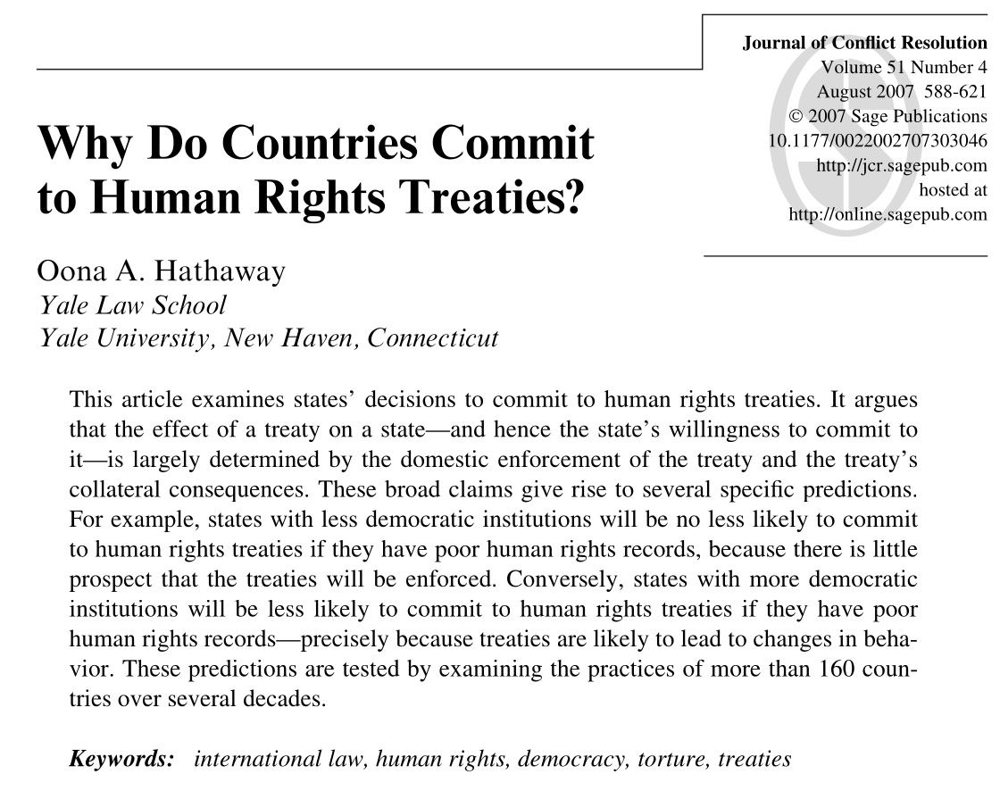
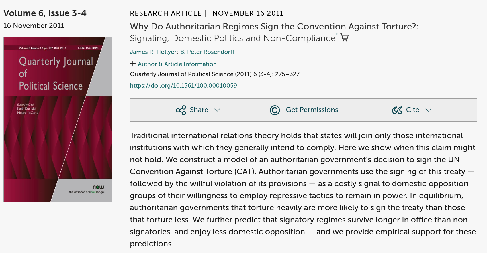
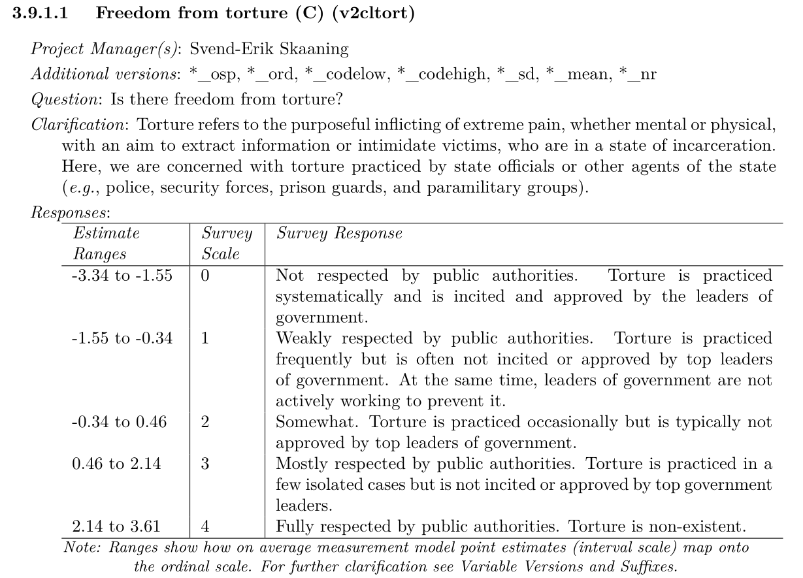

## Today's Agenda {background-image="./Images/background-scales_justice_v3.png" .center}

```{r}
# background-size="1920px 1080px"
library(tidyverse)
library(readxl)
library(lubridate)

# Data input
# Format dates
# Add years to ratify - 10 December 1984

right_censor_delay <- as.numeric(ymd("2025-12-31") - ymd("1984-12-10"))

d <- read_excel("../../Data/DATA-CAT_VDem_Polyarchy-1980-2025.xlsx", na = "NA") |>
  rename("signed_date" = `Signature Date`, "binding_date" = `Binding Date`) |>
  mutate(
    signed_date = ymd(str_remove(signed_date, " 00:00:00")),
    binding_date = ymd(str_remove(binding_date, " 00:00:00")),
    rat_delay = as.numeric(binding_date - ymd("1984-12-10")),
    rat_delay2 = if_else(is.na(rat_delay), right_censor_delay, rat_delay),
    rat_delay_yrs = as.numeric(rat_delay2 / 365)
  )

d2 <- d |>
  pivot_longer(cols = VDem_Torture1980:VDem_Torture2025, names_to = "torture_year", values_to = "torture", names_prefix = "VDem_Torture")
```

<br>

**Section 2: How effective have international institutions been in reducing the use of torture by governments around the world?**

- Replicating and extending the findings of Hathaway (2007) and Hollyer and Rosendorff (2011)

<br>

::: r-stack
Justin Leinaweaver (Fall 2026)
:::

::: notes

**Prep for Class**

1. Review Canvas submissions

2. DATA-CAT_VDem_Polyarchy-1980-2025.xlsx

3. Have the V-Dem codebook if you need it

<br>

This week we've been exploring some of the academic research that has investigated our research question

**SLIDE**: We started with Oona Hathaway's (2007) article

:::


## {background-image="./Images/background-scales_justice_v3.png" .center}

<br>

{style="display: block; margin: 0 auto"}

::: notes

**What were Hathaway's conclusions?**

- **When should we expect states to join a human rights treaty like the Convention Against Torture?**

- (Democracies with weaker executives will be more likely to join)

- (States with large NGO populations will be more likely to join)

- (States surrounded by states that join will be more likely to join)

- (New states may join to bolster their image as good actors)

- (Perverse incentive 1: Bad states more likely to join because no fear of bad consequences)

<br>

**And what states should we expect to avoid ratifying the CAT?**

- (Democracies that torture, or see some value in targeted repression, should NOT join)

- (Perverse incentive 2: Good states afraid to join because fear of consequences or repercussions from added oversight (domestic and international))

<br>

**SLIDE**: Then last class we shifted to the article by Hollyer and Rosendorff from 2011

:::


## {background-image="./Images/background-scales_justice_v3.png" .center}

<br>

{style="display: block; margin: 0 auto"}

::: notes

H&R developed a formal model to help us understand how dictatorships would approach the Convention Against Torture

- **What were their conclusions?**

- (Dictators who torture join the CAT more than non-torturers)

- (Dictators who join the CAT stay in office longer)

- (Dictators fighting in civil wars who join the CAT see the opposition weaken in the following years)

- (Dictators who join the CAT may increase or decrease their use of repression in future years)

    - "This depends on the net result of two contrasting effects: the information effect of the CAT — by which opposition groups reduce their anti-regime efforts following signing — and the commitment effect — by which incumbent regimes cling more ferociously to power to avoid the post-tenure punishments associated with torture" (310).

<br>

**SLIDE**: Our work for today

:::


## {background-image="./Images/background-scales_justice_v3.png" .center}

**How effective have international institutions been in reducing the use of torture by governments around the world?**

- [Week 6: Defining and Measuring the Outcome]{style="color:gray;"}

- [Week 7: The Convention Against Torture (CAT)]{style="color:gray;"}

- **Week 8: Explaining the Effect of the CAT on Torture**

- [Week 9: The International Criminal Court (ICC)]{style="color:gray;"}

- [Week 10: Can the ICC help us reduce global torture?]{style="color:gray;"}

- [Week 11: Case Studies of ICC Effectiveness]{style="color:gray;"}

::: notes

We've now read and analyzed two pieces of literature that each sought to answer our research question.

- I explained previously that engaging with the academic literature is a VITAL step to answering a research question

<br>

It turns out there is one additional step that takes this engagement into even more useful places: replication and extension

- **SLIDE**: Replications are awesome

:::


## {background-image="./Images/background-scales_justice_v3.png" .center}

**Replication is a phenomenal method for:**

::: {.incremental}

1. Deepening your **understanding** of a research topic, 

2. Providing a **public service** by rechecking published results,

3. Learning the **structure** of a publishable scientific analysis, and

4. Practicing the **skills** needed to execute quantitative research

:::

::: notes

**REVEAL x 4**

<br>

Gary King at Harvard has been arguing for literal decades that replication is an excellent way to teach students to be scientists

- King, G. (1995). Replication, replication. *PS: Political Science & Politics*, 28(3), 444-452.

- King, G. (2006). Publication, publication. *PS: Political Science & Politics*, 39(1), 119-125.

<br>

Even better for us, both articles this week are ripe for replication and extension

- The data in the Hathaway article ended in 2005 and the Hollyer and Rosendorff data ended in 1998!

    - Our V-dem data reaches to 2025!

- The articles focused on the CIRIGHTS measure of torture which doesn't capture much variation in institutional approaches to terrorism

    - Our V-Dem measures have five levels and way more global variation

<br>

So, let's use our work today to do some replicating and extending!

- Before we share your replication work we need to clarify some things

- **SLIDE**: Canvas Q1

:::


## {background-image="./Images/background-scales_justice_v3.png" .center}

**Can we use the electoral democracy index (v2x_polyarchy) from V-Dem to replicate and extend the analyses from this week?**

::: {.fragment}
- Hathaway's democracy focuses on weaker executives and institutions that allow non-state actors to hold the government accountable for breaking international laws
:::

::: {.fragment}
- H&R's authoritarian regimes lack accountability institutions that allows "elites" to use force to hold onto power
:::

::: notes

For the first Canvas question I asked you to think critically about the V-Dem measure of electoral democracy

- The question for us is, can we use this measure to examine the specific mechanisms being studied in the research articles?

<br>

Before we share your strengths and weaknesses, let's make sure we're on the same page in terms of targets

- **What specific mechanisms is Hathaway (2007) focused on under the label "democracy"?**

- (**REVEAL**)

-  (e.g. independent judiciary, opposition parties, etc)

<br>

- **What specific mechanisms are Hollyer and Rosendorff (2011) focused on under the label "authoritarian systems"?**

- (**REVEAL**)

- (e.g. independent judiciary, opposition parties, etc)

<br>

Ok, now let's talk strengths and weaknesses

- **How close does the V-Dem electoral democracy index come to representing these mechanisms?**

- (freedom of expression, v2x_freexp_altinf, p49-50)
- (freedom of association, v2x_frassoc_thick, p50)
- (suffrage, v2x_suffr, p50-51)
- (clean elections, v2xel_frefair, p51)
- (elected officials, v2x_elecoff, p51-52)

<br>

**SLIDE**: Classifying democracies and dictatorships using the V-Dem electoral democracy index

:::


## {background-image="./Images/background-scales_justice_v3.png"}

**Classifying States Using the Electoral Democracy Index**

```{r, fig.asp=.618, fig.align='center'}
d |>
  filter(!is.na(polyarchy_median)) |>
  ggplot(aes(y = polyarchy_median, x = reorder(country_text_id, polyarchy_median))) +
  geom_point() +
  geom_segment(aes(y = polyarchy_25th, yend = polyarchy_75th)) +
  labs(x = "States", y = "Electoral Democracy Index", caption = "Source: V-Dem (2026)") +
  scale_x_discrete(labels = NULL) +
  theme_bw()
```

::: notes

My visualization here shows the mean polyarchy scores for the states in our dataset along with error bars around them running from the low to the high value for each

- In order to do the replications themselves we need to decide how to classify the states in the dataset as democracies or dictatorships

- OR, if that's not possible, then we need to decide where to draw the line between "low" and "high" scores of electoral democracy

<br>

**SO, how did you use the V-Dem electoral democracy index to split the sample between high and low scores in the replication?**

- *DISCUSS*

<br>

**SLIDE**: A cut-off of .5

:::


## {background-image="./Images/background-scales_justice_v3.png"}

**Classifying States Using the Electoral Democracy Index**

```{r, fig.asp=.618, fig.align='center'}
d |>
  filter(!is.na(polyarchy_median)) |>
  mutate(
    #poly_group = if_else(polyarchy_median > .5, "democracy", "dictatorship")
    poly_group = case_when(
      polyarchy_25th > .5 ~ "democracy",
      polyarchy_75th <= .5 ~ "dictatorship",
      TRUE ~ "anocracy"
    )
  ) |> 
  ggplot(aes(y = polyarchy_median, x = reorder(country_text_id, polyarchy_median))) +
  geom_point(aes(color = poly_group)) +
  geom_segment(aes(y = polyarchy_25th, yend = polyarchy_75th)) +
  labs(x = "States", y = "Electoral Democracy Index", caption = "Source: V-Dem (2026)") +
  scale_x_discrete(labels = NULL) +
  theme_bw()  +
  guides(color = "none") +
  scale_color_manual(values = c("yellow", "blue", "red"))
  
  #geom_hline(colour = "red", yintercept = .5)
```

::: notes

As I understand it, the rough dichotomous approximation of polyarchy used by the V-Dem researchers is a cut-off at .5

- polyarchy > .5 = electoral democracy

- polyarchy <= .5 = dictatorship

- There are other measures in the dataset that do this alongside a few other tweaks (v2x_regime), but this approach basically captures 90% of the variation in those alternative measures

<br>

For my replication work today I classified states as:

- democracies if their 25th percentile polyarchy score was above .5

- dictatorships if their 75th percentile score was below .5

- and the rest as anocracies (the label the Polity project uses for the middles scores)

- My aim was to be sure I was focusing on states that spent most of the period in the group we are analyzing

<br>

**SLIDE**: Ok, let's classify states by torture

:::


## {background-image="./Images/background-scales_justice_v3.png" .center}

**Did you consolidate the levels of torture?**

```{r, fig.asp=0.618, fig.align='center'}
d2 |>
  ggplot(aes(x = torture)) +
#  geom_histogram(color = "white") +
  geom_bar(fill = RColorBrewer::brewer.pal(n = 5, name = "RdBu"), width = .7) +
  theme_bw() +
  labs(x = "V-Dem Torture (ordinal measure)", y = "Count", caption = "Source: V-Dem (2026)")
```

::: notes

{width="800"}

<br>

**Did you choose to split the sample between high and low torture scores in the replications or examine all the levels?**

- *DISCUSS*

<br>

**SLIDE**: Alright, let's get to the replications!

:::


## Replication 1 {background-image="./Images/background-scales_justice_v3.png" .center}

<br>

**Domestic enforcement capacity matters (Hathaway 2007)**

- Are democracies that use torture slower to ratify the CAT than other democracies?

::: notes

*Split class into groups*

- Groups, share how you attacked this question and agree on a single answer then report back

<br>

**Ok, groups, walk us through your process**

- *PRESENT and DISCUSS each*

- **YOU** *track on the board, help them see how to write the steps*

<br>

**SLIDE**: My versions to discuss

- Direct replication of Hathaway so data up to 2005

- All years so new DV: ratification delay

:::


## {background-image="./Images/background-scales_justice_v3.png" .center .smaller}

**Domestic enforcement capacity matters (Hathaway 2007)**

<br>

**Process**

1. Filter the dataset to only include years up to 2005 (match Hathaway)

2. Remake the "Binding" variable up to 2005 

3. Convert polyarchy into three-level nominal variable

    - "democracy" = polyarchy_25th > .5
    - "dictatorship" = polyarchy_75th < .5
    - "anocracy" = rest of cases

4. Calculate the average torture level (5 years = 1980 - 1984)

5. Make a violin plot of regime type x torture level x binding decision

::: notes

It is hard to directly replicate Hathaway's work because she is using a Cox proportional hazards model

- Essentially she's running a fancy regression on the data and we're trying to replicate it with much simpler methods

<br>

As you remember from your various statistics classes, variable type determines tool

- In this case we have two categorical variables and a numeric variable, so that means a box plot, a violin plot or overlapping densities

- **SLIDE**: Let's look at the violin plots!

:::


## {background-image="./Images/background-scales_justice_v3.png" .center}

**Domestic enforcement capacity matters (Hathaway 2007)**

```{r, fig.align='center', fig.asp=.618}
# Who had ratified or not by 2005?
# violin plots
d |>
  mutate(
    poly_group = case_when(
      polyarchy_25th > .5 ~ "Democracy",
      polyarchy_75th <= .5 ~ "Dictatorship",
      TRUE ~ "Anocracy"
    ),
    binding2005 = if_else(binding_date <= ymd("2005-12-31"), "Participant", "Non-Participant", missing = "Non-Participant"),
    binding_all = if_else(Binding == 1, "Participant", "Non-Participant", missing = "Non-Participant"),
    torture_mean_5yr = (VDem_Torture1980 + VDem_Torture1981 + VDem_Torture1982 + VDem_Torture1983 + VDem_Torture1984) / 5
  ) |>
  ggplot(aes(x = poly_group, y = torture_mean_5yr, fill = binding2005)) +
  geom_violin() +
  scale_x_discrete(limits = c("Dictatorship", "Anocracy", "Democracy")) +
  labs(x = "", y = "Average Torture Level (1980 - 1984)", fill = "The Convention Against Torture (up to 2005)") +
  theme_bw() +
  theme(legend.position = "top") +
  scale_fill_manual(values = c("red3", "lightblue"))

# # Density overlapping
# d |>
#   mutate(
#     poly_group = case_when(
#       polyarchy_25th > .5 ~ "Democracy",
#       polyarchy_75th <= .5 ~ "Dictatorship",
#       TRUE ~ "Anocracy"
#     ),
#     binding2005 = if_else(binding_date <= ymd("2005-12-31"), "Participant", "Non-Participant", missing = "Non-Participant"),
#     torture_mean_5yr = (VDem_Torture1980 + VDem_Torture1981 + VDem_Torture1982 + VDem_Torture1983 + VDem_Torture1984) / 5
#   ) |>
#   ggplot(aes(x = torture_mean_5yr, fill = binding2005)) +
#   geom_density() +
#   #scale_x_discrete(limits = c("Dictatorship", "Anocracy", "Democracy")) +
#   facet_wrap(~ poly_group)

# # scatter...
# d |>
#   mutate(
#     binding2005 = if_else(binding_date <= ymd("2005-12-31"), "Participant", "Non-Participant", missing = "Non-Participant"),
#     torture_mean_5yr = (VDem_Torture1980 + VDem_Torture1981 + VDem_Torture1982 + VDem_Torture1983 + VDem_Torture1984) / 5
#   ) |>
#   ggplot(aes(x = polyarchy_median, y = torture_mean_5yr, color = binding2005, shape = binding2005)) +
#   geom_point(size = 3) +
#   geom_smooth(method = "lm", se = FALSE)


# # bar plot: regime type in three levels x ratification dummy x torture in 1984
# d |>
#   #filter(torture_year <= 2005) |>
#   mutate(
#     poly_group = case_when(
#       polyarchy_25th > .5 ~ "Democracy",
#       polyarchy_75th <= .5 ~ "Dictatorship",
#       TRUE ~ "Anocracy"
#     ),
#     binding2005 = if_else(binding_date <= ymd("2005-12-31"), "Participant", "Non-Participant", missing = "Non-Participant")
#   ) |>
#   filter(!is.na(VDem_Torture1984)) |>
#   ggplot(aes(x = factor(VDem_Torture1984), fill = binding2005)) +
#   geom_bar(position = "fill") +
#   facet_wrap(~ poly_group)
```

::: notes

A violin plot is a visualization that shows how numbers are spread out by combining a box plot and a density curve

- The sides of each violin represent the density curve

- The length of each violin tells you the approximate range of the data in that group

    - So, the dictatorships up to 2005 have torture scores running from 0 - 3
    
    - The democracies run the full gamut!

- The widest parts of each violin are where most of the observations are in that group

    - Democracies that didn't join CAT by 2005 are heavily in the 3 range for torture

<br>

**So, what do we see here?**

- **Is this consistent with Hathaway's findings?**

<br>

- The torture levels for dictatorship look VERY similar for the participants and the non-participants

    - Confirms Hathaway: suggests torture is not a strong predictor of participation for them

- BUT anocracies and democracies DO show a difference

    - There appear to be a group of democracies and anocracies where torture is practiced in "isolated cases" but is not approved by the leaders of those states
    
    - Points in the general direction of Hathaway but a weak result
    
<br>

**If we had perfectly replicated Hathaway's findings, what would the two violins look like in the democracies?**

- (Two much more separate distributions)

- The red violin higher and the blue violin lower

- **Does that make sense?**

<br>

**SLIDE**: Shifting to ratification delay as the outcome variable

:::


## {background-image="./Images/background-scales_justice_v3.png" .center .smaller}

**Domestic enforcement capacity matters (Hathaway 2007)**

<br>

**Process**

1. Filter the dataset to only include "democracies" (polyarchy_25th > .5)

2. Calculate the ratification delay in years (binding_date - "1984-12-10")

    - States that have not joined are given a binding date of 2025-12-31 (right-censored)

3. Calculate the mean torture level in the five years preceding the adoption of the CAT (1980 - 1984)

4. Make a scatter plot of mean torture level by ratification delay


## {background-image="./Images/background-scales_justice_v3.png" .center}

```{r, fig.asp=.618, fig.align='center'}
# Are democracies that use torture slower to ratify the CAT than other democracies?
# Focus on democracies
# Classify by their level of torture from 1980 to 1984

d_temp <- d |>
  #filter(polyarchy_median > .5) |>
  filter(polyarchy_25th > .5) |>
  mutate(
    binding_all = if_else(Binding == 1, "Participant", "Non-Participant", missing = "Non-Participant"),
    torture_mean_5yr = (VDem_Torture1980 + VDem_Torture1981 + VDem_Torture1982 + VDem_Torture1983 + VDem_Torture1984) / 5,
    torture_mean_10yr = (VDem_Torture1980 + VDem_Torture1981 + VDem_Torture1982 + VDem_Torture1983 + VDem_Torture1984 + VDem_Torture1985 + VDem_Torture1986 + VDem_Torture1987 + VDem_Torture1988 + VDem_Torture1989) / 10
  )

d_temp_labs <- d_temp |>
  filter(rat_delay_yrs > 10 | torture_mean_5yr < 1)

d_temp |> 
  ggplot(aes(x = jitter(torture_mean_5yr, amount = .1), y = rat_delay_yrs)) +
  geom_point() +
  geom_smooth(se = FALSE) +
  ggrepel::geom_text_repel(data = d_temp_labs, aes(labels = country)) +
  theme_bw() +
  labs(x = "Freedom from Torture (1980-1984, mean)", y = "Ratification Delay (years)", title = "Does domestic enforcement capacity matter for democracies? (Hathaway 2007)",
       caption = "Source: V-Dem (2026) and the UNTC (2026")
```


::: notes

This scatter plot visualizes the "democracies in the dataset by two characteristics:

- X-axis: Average level of torture from 1980-1984

- y-axis: Number of years it took them to ratify the CAT

- I've added a little jitter to the torture score to help us see the different points

- I also tested this with different numbers of years in the torture mean (5 vs 10) and it didn't change the results

<br>

**What does this suggest about the relationship between the use of torture and ratification of the CAT in democracies?**

- (Line slope is positive suggesting less torture is associated with slightly longer ratification delays)

    - And WAY longer time in Suriname, Sao Tome, the DR and Vanuatu!
    
    - Category 3 is very intriguing, e.g. democracies who mostly do not torture. Is this the effect Hathaway suggested?
    
- BUT, at level 4 with the least torture the delay falls back down
    
<br>

**What are the strengths and weaknesses of providing this as your answer to the first question?**

- *DISCUSS*

<br>

**Ok, do we walk away more or less convinced by Hathaway's (2007) argument about domestic enforcement capacity mattering in democracies?**

- Depends on how much we want to focus on that collection of outliers in torture category 3

- Is that hesitancy due to domestic enforcement?

- If so, why don't we see it continue where torture is higher on the left side of the plot?

<br>

**SLIDE**: Replication 2

:::


## Replication 2 {background-image="./Images/background-scales_justice_v3.png" .center}

<br>

**Domestic enforcement capacity matters (Hathaway 2007) and torture as costly signaling mechanism (Hollyer and Rosendorff 2011)**

- Are dictatorships that use torture faster to ratify the CAT than other states?

::: notes

Groups, share how you attacked this question and agree on a single answer then report back

<br>

*PRESENT and DISCUSS each: Walk us through your process*

<br>

**SLIDE**: My version to evaluate

:::


## {background-image="./Images/background-scales_justice_v3.png" .center}

```{r, fig.asp=.618, fig.align='center'}
# Are dictatorships that use torture faster to ratify the CAT than other states?

d_temp <- d |>
  filter(polyarchy_75th <= .5) |>
  mutate(
    binding_all = if_else(Binding == 1, "Participant", "Non-Participant", missing = "Non-Participant"),
    torture_mean_5yr = (VDem_Torture1980 + VDem_Torture1981 + VDem_Torture1982 + VDem_Torture1983 + VDem_Torture1984) / 5
  )

d_temp_labs <- d_temp |>
  filter(rat_delay_yrs > 20 | rat_delay_yrs < 10)

d_temp |> 
  ggplot(aes(x = jitter(torture_mean_5yr, amount = .1), y = rat_delay_yrs)) +
  geom_point() +
  geom_smooth(se = FALSE) +
  ggrepel::geom_text_repel(data = d_temp_labs, aes(labels = country)) +
  scale_x_continuous(limits = c(0, 4)) +
  theme_bw() +
  labs(x = "Freedom from Torture (1980-1984, mean)", y = "Ratification Delay (years)",
       title = "Dictatorships lack enforcement capacity and may see torture as a costly signal",
       subtitle = "(Hathaway 2007; H&R 2011)",
       caption = "Source: V-Dem (2026) and the UNTC (2026")
```

::: notes

Same approach as before but now focusing on dictatorships

<br>

**What does this suggest about the relationship between the use of torture and ratification of the CAT in dictatorships?**

- (Super hard to interpret)

- Scary that there are no free from torture states ("4"s) in the dictatorships

- (Lots of variation within each category)
    
<br>

**What are the strengths and weaknesses of providing this as your answer to the first question?**

- *DISCUSS*

<br>

**Ok, do we walk away more or less convinced by the perverse incentives proposed by Hathaway (2007) and the costly signaling proposed by H&R (2011)?**

<br>

**SLIDE**: Replication 3

:::


## Replication 3 {background-image="./Images/background-scales_justice_v3.png" .center}

<br>

**Changes in torture levels after joining CAT (Hollyer and Rosendorff 2011)**

- Do dictatorships that ratify the CAT increase or decrease their use of torture after joining? If so, how much and in which direction?

::: notes

Groups, share how you attacked this question and agree on a single answer then report back

<br>

*PRESENT and DISCUSS each: Walk us through your process*

<br>

**SLIDE**: My versions to evaluate

:::


## {background-image="./Images/background-scales_justice_v3.png" .center .smaller}

::: {.r-fit-text}
**Changes in torture levels after joining CAT (Hollyer and Rosendorff 2011)**
:::

<br>

**Process**

1. Filter the dataset to only dictatorships (polyarchy_75th <= .5)

2. Create a variable to identify country-years pre and post ratification

3. Calculate the mean torture level for each state: pre vs post ratification

4. Calculate the difference between the pre vs post ratification torture means

5. Visualize the pre-ratification means for each dictatorship and add an arrow segment showing the changes in torture post-ratification


## {background-image="./Images/background-scales_justice_v3.png" .center}

```{r, fig.asp=.618, fig.align='center'}
# Do dictatorships that ratify the CAT increase or decrease their use of torture after joining? If so, how much and in which direction?

# d_temp_labs2 <- d2 |>
#   filter(polyarchy_median <= .5) |>
#   filter(torture_year <= year(binding_date)) |>
#   group_by(country_text_id) |>
#   summarize(
#     mean_torture = mean(torture, na.rm = T) 
#   ) |>
#   filter(!is.na(mean_torture)) |>
#   arrange(mean_torture)

d2_temp <- d2 |>
  filter(polyarchy_75th <= .5) |>
  mutate(
    groups1 = if_else(torture_year > year(binding_date), "Post-Ratification", "Pre-Ratification")
  ) |>
  filter(!is.na(groups1)) |>
  group_by(country_text_id, groups1) |>
  summarize(
    mean_torture = mean(torture, na.rm = T) 
  ) |>
  ungroup() |>
  pivot_wider(names_from = groups1, values_from = mean_torture) |>
  na.omit() |>
  mutate(
    Difference1 = `Post-Ratification` - `Pre-Ratification`,
    diff_group = if_else(Difference1 > 0, "Positive", "Negative")
  )

# table(d2_temp$Difference1 > 0)
# table(d2_temp$Difference1 < 0)
# table(d2_temp$Difference1 == 0)
#summary(d2_temp$Difference1)
# summary(d2_temp$Difference1[d2_temp$Difference1 > 0])
# summary(d2_temp$Difference1[d2_temp$Difference1 < 0])


d2_temp |>
  ggplot(aes(x = reorder(country_text_id, `Pre-Ratification`), y = `Pre-Ratification`)) +
  #geom_point(aes(y = `Post-Ratification`), color = "blue") +
  geom_point(color = "black") +
  geom_segment(aes(y = `Pre-Ratification`, yend = `Post-Ratification`, color = diff_group), arrow = arrow(length = unit(0.1, "inches"))) +
  theme_bw() +
  scale_y_continuous(limits = c(0, 4)) +
  scale_x_discrete(labels = NULL) +
  labs(x = "Dictatorships (V-Dem)", y = "Mean Freedom from Torture (V-Dem)", caption = "Source: V-Dem (2026), UNTC (2026)",
       title = "Pre vs Post-CAT Ratification by Dictatorships") +
  scale_color_manual(values = c("red", "blue"))  +
  guides(color = "none") +
  annotate("text", x = 3, y = 3.8, label = "34 (56%) improved their scores by an average of +0.7", hjust = 0, size = 5, color = "blue") +
  annotate("text", x = 3, y = 3.5, label = "7 (11%) kept the same score", hjust = 0, size = 5, color = "orange") +
  annotate("text", x = 3, y = 3.2, label = "20 (33%) decreased their scores by an average of -0.4", hjust = 0, size = 5, color = "red") 


```

::: notes

**What does this suggest about the relationship between the use of torture and ratification of the CAT in dictatorships?**

- (Seems like good and bad news!)

- The Good: Less torture!

- The Bad: Is it because ratifying the CAT is a successful costly signal that reduces opposition efforts?
    
<br>

**What are the strengths and weaknesses of providing this as your answer to the third question?**

- *DISCUSS*

<br>

**Ok, what is our answer to this question?**

- **Does our expanded and updated analysis agree with the research or not?**

<br>

**SLIDE**: Let's check the same thing for democracies!

:::


## {background-image="./Images/background-scales_justice_v3.png" .center}

```{r, fig.asp=.618, fig.align='center'}
# Replicate for democracies?

d2_temp <- d2 |>
  filter(polyarchy_25th > .5) |>
  mutate(
    groups1 = if_else(torture_year > year(binding_date), "Post-Ratification", "Pre-Ratification")
  ) |>
  filter(!is.na(groups1)) |>
  group_by(country_text_id, groups1) |>
  summarize(
    mean_torture = mean(torture, na.rm = T) 
  ) |>
  ungroup() |>
  pivot_wider(names_from = groups1, values_from = mean_torture) |>
  na.omit() |>
  mutate(
    Difference1 = `Post-Ratification` - `Pre-Ratification`,
    diff_group = if_else(Difference1 > 0, "Positive", "Negative")
  )

# table(d2_temp$Difference1 > 0)
# table(d2_temp$Difference1 < 0)
# table(d2_temp$Difference1 == 0)
#summary(d2_temp$Difference1)
# summary(d2_temp$Difference1[d2_temp$Difference1 > 0])
# summary(d2_temp$Difference1[d2_temp$Difference1 < 0])


d2_temp |>
  ggplot(aes(x = reorder(country_text_id, `Pre-Ratification`), y = `Pre-Ratification`)) +
  #geom_point(aes(y = `Post-Ratification`), color = "blue") +
  geom_point(color = "black") +
  geom_segment(aes(y = `Pre-Ratification`, yend = `Post-Ratification`, color = diff_group), arrow = arrow(length = unit(0.1, "inches"))) +
  theme_bw() +
  scale_y_continuous(limits = c(0, 4)) +
  scale_x_discrete(labels = NULL) +
  labs(x = "Dictatorships (V-Dem)", y = "Mean Freedom from Torture (V-Dem)", caption = "Source: V-Dem (2026), UNTC (2026)",
       title = "Pre vs Post-CAT Ratification by Democracies") +
  scale_color_manual(values = c("red", "blue"))  +
  guides(color = "none") +
  annotate("text", x = 27, y = 1, label = "30 (51%) improved their scores by an average of +1.2", hjust = 0, size = 5, color = "blue") +
  annotate("text", x = 27, y = .7, label = "19 (33%) kept the same score", hjust = 0, size = 5, color = "orange") +
  annotate("text", x = 27, y = .4, label = "9 (15%) decreased their scores by an average of -0.2", hjust = 0, size = 5, color = "red") 


```

::: notes

Come on guys, that's some good results right there!

<br>

**SLIDE**: Next Class

:::


## For Next Class {background-image="./Images/background-scales_justice_v3.png" .center}

<br>

**Principal-Agent Theory and International Organizations**

1. Read some background on PA theory, and

2. International organization (IO) case studies

::: notes


Canvas DISCUSSION: International Organization Case Studies

Select an international organization (IO) from the list maintained by Wikipedia that you think sounds interesting. No overlapping cases; first-come, first-served.

1. What is the IO you have selected?
2. What treaty or instrument created the IO? (Provide a link to the founding document)
3. What year was the IO established?
4. What is something specific and useful this IO has done in the world? The more recent the action, the better. Provide a link to evidence supporting your argument.
5. How do the member states control the IO? In other words, what is at least one limit member states have placed on its ability to do things? You must provide evidence to support your argument.


:::


