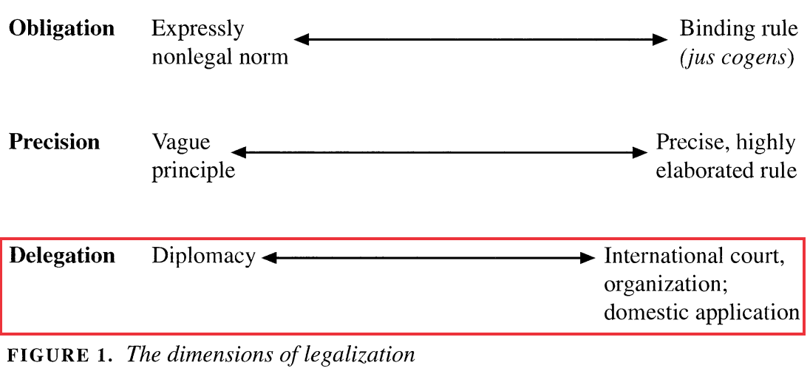
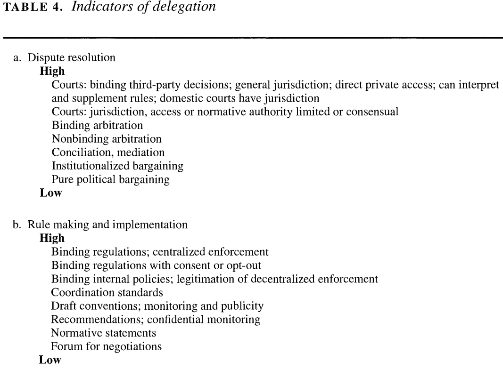
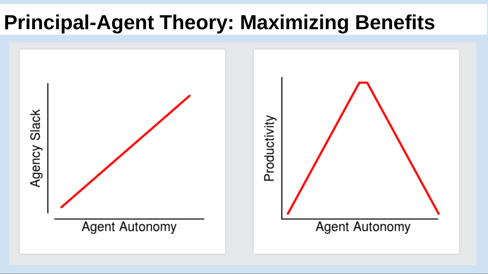
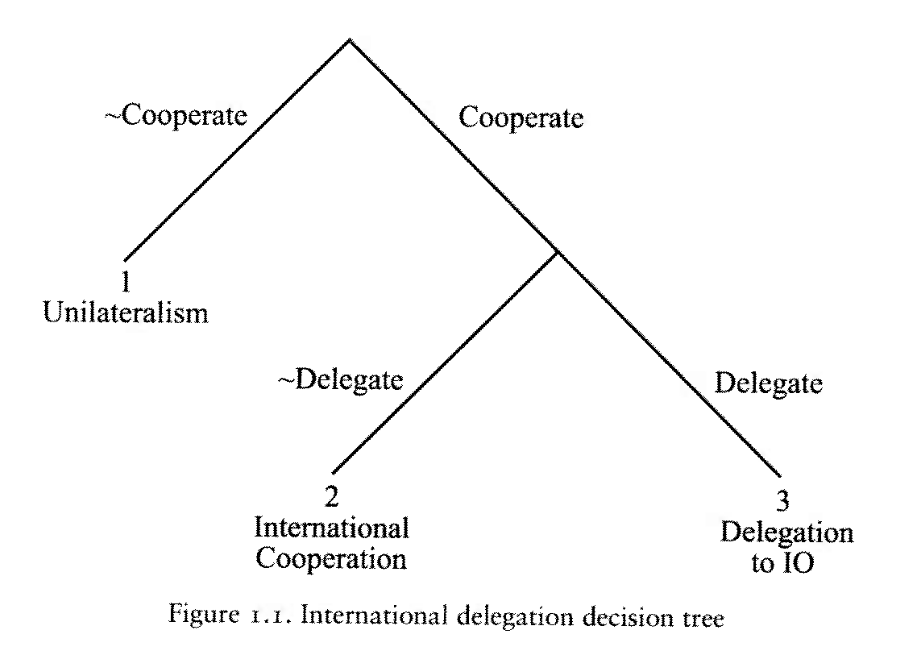

## Today's Agenda {background-image="./Images/background-scales_justice_v3.png" .center}

```{r}
# background-size="1920px 1080px"
library(tidyverse)
library(readxl)
```

<br>

**Section 2: How effective have international institutions been in reducing the use of torture by governments around the world?**

- Principal-Agent Theory

- Hawkins, Lake, Nielson & Tierney (2006). "Delegation Under Anarchy: States, international organizations, and principal-agent theory"

<br>

::: r-stack
Justin Leinaweaver (Fall 2026)
:::

::: notes

**Prep for Class**

1. Review cases submitted to Canvas

<br>

**SLIDE**: The recap

:::


## {background-image="./Images/background-scales_justice_v3.png" .center}

**How effective have international institutions been in reducing the use of torture by governments around the world?**

- Week 6: Defining and Measuring the Outcome

- Week 7: The Convention Against Torture (CAT)

- Week 8: Explaining the Effect of the CAT on Torture 

- Week 9: The International Criminal Court (ICC)

- Week 10: Can the ICC help us reduce global torture?

- Week 11: Case Studies of ICC Effectiveness

::: notes

Section 2 of our class has focused on a big question

- Have international institutions made a significant and positive impact on torture rates around the world?

<br>

**Why should every research project start like we did in Week 6, by analyzing the outcome variable?**

- (The aim of any research project is to explain variation in the world and that means:

1. We understand the challenges of measuring that outcome, and

2. We are sure there is variation to explain!
    
<br>

**And based on our work analyzing the outcome variable, did we determine that there is variation in the use of torture around the world?**

- (Darn right we did!)

<br>

In Week 7 we shifted our analysis to the first predictor variable in our project: the Convention Against Torture (1984)

- **Given the design of the treaty itself, what kinds of real-world effects is it likely to have on its participants?**

- (Increases in information dissemination about torture?)

- (More international meetings focused on the topic?)

- (More requests for investigative assistance across border?)

- (More requests for extradition?)

<br>

In Week 8 we reviewed some of the academic literature on our topic

- **Why does every useful research project have to review the academic literature on its topic?**

- (Building on the shoulders of giants!)

- (OR, maintaining a coherence in the development of knowledge by not continuously trying to reinvent the wheel)

<br>

**And what did we learn from Hathaway (2007), Hollyer and Rosendorff (2011) and our efforts to replicate their work?**

1. (In the absence of international enforcement, domestic enforcement capacity matters)

    - (Hathaway: Domestic enforcement capacity explains ratification UP TO 2005)

    - (Replication: There does appear to be a slower rat process for democracies who use some torture ("3"))

2. ("Bad" states have joined the CAT, possibly for "bad" reasons!)

    - (H&R: The absence of credible international enforcement allows the worst states to use the CAT as a tool of repression!)

    - (Replication: Torture for 60% of dictatorships got better after RAT, BUT is that because opposition effort fell (H&R's arg) or because the treaty compelled better behavior?)

<br>

This week we shift our focus to a second predictor variable

- Since most countries appear to have opted out of the oversight provided by the CAT's "Committee" we need to look elsewhere for enforcement!

- And that brings us to the International Criminal Court

<br>

Analyzing delegation to an IO like the ICC means we need new tools in our toolbox

- **SLIDE**: So, let's talk principal-agent theory

:::


## {background-image="./Images/background-scales_justice_v3.png" .center}

::: {.r-fit-text}
**Why would states delegate power to an external agent?**
:::

{style="display: block; margin: 0 auto"}

::: notes

Principal-Agent Theory is an attempt to help us understand this rather puzzling question.

- Why would a state EVER delegate meaningful powers to an external actor (e.g. agent) outside their sovereign control?

<br>

States tend to jealously defend their sovereignty in essentially all scenarios, so this idea is a genuinely challenging one.

- Clearly, Realists like Mearsheimer and Waltz would be incredibly dismissive of this

- But even institutionalists like the Rational Design team have been pushed to explain the hows, the whys and the "is it meaningful" for cases of delegation in the international arena.

<br>

We've encountered "delegation" before in our study of international institutions!

- **SLIDE**: The legalization concept gives delegation its own category!

:::


## {background-image="./Images/background-scales_justice_v3.png" .center}

::: {.r-fit-text}
**Why would states delegate power to an external agent?**
:::

<br>

**Legalization**

(Abbott, Keohane, Moravcsik, Slaughter & Snidal 2000)

:::: {.columns}
::: {.column width="50%"}
{style="display: block; margin: 0 auto"}
:::

::: {.column width="50%"}
{style="display: block; margin: 0 auto"}
:::
::::

::: notes

The legalization approach investigates delegation in two parts:

- Dispute resolution and rule-making / implementation

<br>

**In what specific ways is the legalization approach to analyzing delegation useful?**

<br>

**Can we use legalization to answer the big "why" question here? Why or why not?**

<br>

Not directly

- Legalization is more a measurement tool than it is an explanation for design choices

- Abbott and Snidal (2000) try to add some of this in their discussion of the strengths and weaknesses of hard vs soft law

<br>

**Can anybody remind us of why states might prefer "harder" forms of delegation according to Abbott and Snidal (2000)?**

1. Makes your commitments more credible,
    
2. Reduces transaction costs, and

3. Allows for incomplete contracting

<br>

So, legalization suggests significant delegation can be useful but is also VERY hard to design and agree upon.

<br>

**SLIDE**: The rational design literature also discusses delegation to third parties in international institutions

:::


## {background-image="./Images/background-scales_justice_v3.png" .center}

::: {.r-fit-text}
**Why would states delegate power to an external agent?**
:::

<br>

**Rational Design**

(Koremenos, Lipson & Snidal 2001)

:::: {.columns}
::: {.column width="50%"}
**Assumptions**

- Rational design

- Shadow of the future

- Transaction costs

- Risk aversion
:::

::: {.column width="50%"}
**Design Choices**

- Membership rules

- Scope of issues

- Centralization of tasks

- Rules for control

- Flexibility of arrangements

:::
::::


::: notes

Here we see the baseline assumptions and design choices proposed by KLS (2001)

- Essentially, the design choices are like legalization, a tool for summary and analysis

- The baseline assumptions are where this approach brings theory to the table and allows us to answer big "why" questions like this one

<br>

**How does the rational design assumption explain why states delegate to an external agent?**

- States and other international actors, acting for self-interested reasons, design institutions purposefully to advance their joint interests.

- IFF an agent facilitates joint interests, it MAY be worth the risk

<br>

**How does the shadow of the future assumption explain why states delegate to an external agent?**

- The value of future gains is strong enough to support a cooperative arrangement.

- IFF an agent's existence helps to extend the likelihood of cooperation over the long-term, it MAY be worth the risk

<br>

**How does the transaction costs assumption explain why states delegate to an external agent?**

- Establishing and participating in international institutions is costly.

- IFF an agent can mitigate the costs of running an institution, it MAY be worth the risk

<br>

**How does the risk aversion assumption explain why states delegate to an external agent?**

- States are risk-averse and worry about possible adverse effects when creating or modifying international institutions.

- IFF an agent can mitigate the risks of running an institution, it MAY be worth the risk

<br>

**Does this make sense?**

<br>

This comes a lot closer to offering us an answer to our question.

- HOWEVER, it opens up the possibility of delegation without necessarily helping us think through the implications of delegation as a design choice.

<br>

Your reading for today from Hawkins, Lake, Nielson and Tierney (2006) is meant to do just that.

- They propose elements of theory and design meant to help us be more sophisticated when thinking about international principals and their agents

- **SLIDE**

:::


## {background-image="./Images/background-scales_justice_v3.png" .center}

::: {.r-fit-text}
**Principal-Agent Theory (Hawkins, Lake, Nielson & Tierney 2006)**
:::

<br>

::: {.fragment}

"Delegation is a conditional grant of authority from a principal to an agent that empowers the latter to act on behalf of the former" (4).

- Always governed by a contract

- Limited in time or scope

- Must be revocable

- Roles are mutually constitutive

:::
::: notes

To be clear, principal-agent theory has a long and storied history across the fields of political science and business

- This makes sense because the challenges facing a business owner with his employees and a state executive with his government are often quite similar

<br>

The authors I am citing here took PA theory into the context of international institutions

- This is THE citation for thinking about member states as principals and IOs as agents

<br>

Let's start big picture with defining our terms

- **How do Hawkins, Lake, Nielson & Tierney (2006) define delegation?**

- (**REVEAL**)

<br>

The definition itself is quite simple which helps keep it focused

- Unlike legalization this does not tie delegation to only specific categories of tasks like rule making or dispute resolution

- Unlike rational design this is not an approach rooted in set ideas about what motivates the principals in question

- The conditions of delegation proposed here as part of the definition are how we start to answer the big question: Why would any principal delegate to an external agent?

<br>

**What does "always governed by a contract" mean and why should member state principals ALWAYS require this condition?**

- (An explicit contract makes the exact limits and expectations of the relationship clear for all parties)

- (Delegations to an IO threaten sovereignty so you should want in writing how much and under what specific conditions those infringements are allowed)

<br>

**What does "limited in time or scope" mean and why should principals ALWAYS require this condition?**

- (Limited in time or scope means the power transfer is expressly limited from the beginning)

- (Similar reasons to the above (protect sovereignty), but presents time and scope as trade-offs: either grant big power over a tiny area (scope) or for a limited time)

<br>

**What does "must be revocable" mean and why should principals ALWAYS require this condition?**

- (Revocable agency means the agent can be fired; the power transfer is NOT permanent)

- (No state will willingly cede sovereignty permanently)

<br>

**What does "roles are mutually constitutive" mean and why should principals ALWAYS require this condition?**

- (The agent is only an agent, with all rights and privileges attached, so long as it works for the principal under the terms the principal has elaborated)

    - Not really an independent actor AT ALL
    
    - The ICC only exists so long as it is emplyed by me by the terms I have set

<br>

So, a first answer to the question, why would states delegate power to an external agent?, is that delegation is a much more limited and controlled state of affairs than you might otherwise assume!

<br>

But that's not all!

- **SLIDE**: If designed well, there are at least six distinct benefits of delegation to the principal

:::


## {background-image="./Images/background-scales_justice_v3.png" .center}

::: {.r-fit-text}
**Principal-Agent Theory (Hawkins, Lake, Nielson & Tierney 2006)**
:::

<br>

**The Benefits of Delegation**

1. Divide the labor & create gains from specialization

2. Managing policy externalities

3. Facilitating collective decision-making

4. Resolving disputes

5. Enhancing credibility

6. Creating policy bias

::: notes

These six items help PA theory to explain why states would delegate significant authorities to a third party agent

- Think of this like adding more detail to the rational design conjectures but focused on delegation

- Each of these benefits allows us to overcome a specific kind of challenge in designing an international institution

<br>

Ok, split into pairs, then share with each other IO case you brought to class today

- THEN help each other to identify which of the six benefits on this list your examples illustrate

- My hope is that each case covers AT LEAST ONE of these benefits

- Go!

<br>

Ok, let's step through these benefits as we see them in the real world!

- Remember, each of these is a design solution to a specific problem

<br>

Benefit 1 is "Divide the labor & create gains from specialization"

- **What is the problem this benefit is trying to solve?**

- (PROBLEM: frequent, repetitive tasks that require specific knowledge benefit from being delegated, agent gets better at them over time)

- **And how can an agent address it?** 

- (SOLUTION: Create a specialized agent (ICC, World Bank, IMF))

- **Who has an example of an IO dividing the labor and creating gains from specialization? Tell us about it!**

<br>

Benefit 2 is "Managing policy externalities"

- **What is the problem this benefit is trying to solve?**

- (PROBLEM 1: Coordination games (chicken game) the policy outcome doesn't matter as long as everyone does the same thing. Let the agent dictate.)

- (PROBLEM 2: Collaboration games (PD): States want to defect, delegate to an agent to provide the good for you or to monitor and publicize bad behavior.)

- **And how can an agent address it?** 

- (SOLUTION 1: A coordinating agent like the International Postal Union)

- (SOLUTION 2: A collaboration agent like the CoE, OECD, IAEA)

- **Who has an example of an IO managing policy externalities? Tell us about it!**

<br>

Benefit 3 is "Facilitating collective decision-making"

- **What is the problem this benefit is trying to solve?**

- (PROBLEM: Vote cycling problems or other preference instabilities; Basics of vote cycling: No condorcet winner (an option that beats all others in pairwise competition)

- **And how can an agent address it?** 

- (SOLUTION: Agenda-setting Agent: Agent with agenda setting power can help like the European Commission)

- **Who has an example of an IO facilitating collective decision-making? Tell us about it!**

<br>

Benefit 4 is "Resolving disputes"

- **What is the problem this benefit is trying to solve?**

- (SOLUTION: Create a specialized agent (ICC, World Bank, IMF))

- **And how can an agent address it?** 

- (SOLUTION: Create an arbitrating agent)

    - Incomplete contracting has lower future transaction costs if you create an arbitrating agent.
    
    - Arrange careful rules so states can give the IO the authority AND autonomy to handle these unplanned for events.

- **Who has an example of an IO resolving disputes? Tell us about it!**

<br>

Benefit 5 is "Enhancing credibility"

- **What is the problem this benefit is trying to solve?**

- (PROBLEM: time-inconsistency problem, e.g. long-term interests may not be same as short-term interests)

- **And how can an agent address it?** 

- (SOLUTION: Create an enforcing agent like the ECB)

    - Enforcing agents: with high discretion to push policy in the direction desired over the long-term. Makes it hard for states to cheat to grab short-term gains.
    
    - Delegating authority to an IO is a demonstrable action that ties a state’s hands more than simple talk.

- **Who has an example of an IO enhancing credibility? Tell us about it!**

<br>

Benefit 6 is "Creating policy bias"

- **What is the problem this benefit is trying to solve?**

- (PROBLEM: Policy creates winners and losers but how do you ensure your preferences remain in place long after you're gone?)

- **And how can an agent address it?** 

- (SOLUTION: Create lock-in with policy-biased agents)

    - These agents can then be counted on to set the rules of behavior of the IO so that your power is protected even if the balance shifts over time
    
    - e.g. post civil war create institutions with voting rules balanced across ethnic groups)
    
    - e.g. the UN Security Council which reflects power dynamics in 1945 but keeps them central today)

**Who has an example of an IO creating policy bias? Tell us about it!**

<br>

**Any questions on these six benefits?**

<br>

**SLIDE**: Let's now talk about the other side of this coin

:::


## {background-image="./Images/07_1-Agent_Slack.jpg" .center}

::: notes

Clearly from these examples, delegation can provide substantial benefits to a principal.

- AND, these specific problems we've just discussed come up ALL the time

- The drawback is what the authors refer to as "agency slack"

<br>

**According to the reading, what is agency slack?**

- (p5; “...independent action by an agent that is undesired by the principal.”)

<br>

The chapter defines two types of "slack."

<br>

**1. What is "shirking" and give me an example from your work lives?**

- (“...when an agent minimizes the effort it exerts on its principal’s behalf.”)

- Facebook time while at your desk.

<br>

**2. What is slippage and give me an example?**

- (“...when an agent shifts policy away from its principal’s preferred outcome and toward its own preference”)

- I hire a realtor to help me buy a house at the lowest price.

    - They get paid as a % of the selling price so their incentive is to keep the price higher than I'd like but low enough that I don't walk away.

<br>

**Everybody clear on those forms of agency loss?**

<br>

**SLIDE**: The challenge for the principal is how to set up agent to maximize the benefits they produce

:::


## {background-image="./Images/background-scales_justice_v3.png" .center}

```{r, fig.align='center', fig.height=5, fig.width=6}
# The relationship between agent autonomy and productivity
# the good
d1 <- tibble(
  x1 = 1:5,
  y1 = c(1:5)
)

# the problem
d2 <- tibble(
  x1 = 1:10,
  y1 = c(1:5, 5:1)
)

# Set up the plot: explain the axes
ggplot(data = d1, aes(x = x1, y = y1)) +
  geom_line(linewidth = 0) +
  theme_bw() +
  labs(x = "Agent Autonomy", y = "Productivity") +
  scale_x_continuous(labels = NULL) +
  scale_y_continuous(labels = NULL)
```

::: notes

Let's examine the relationship between agent autonomy and productivity

- For simplicity let's just imagine you own a widget factory

<br>

- By productivity I mean how much additional output your agent can produce for you

- By agent autonomy I mean how much freedom you give them to do their job

<br>

**SLIDE**: Zero autonomy

:::


## {background-image="./Images/background-scales_justice_v3.png" .center}

```{r, fig.align='center', fig.height=5, fig.width=6}
# Principal hires an agent and stands over their shoulder watching them work for the entire day
# Zero autonomy, zero added productivity
ggplot(data = d1, aes(x = x1, y = y1)) +
  geom_line(linewidth = 0) +
  theme_bw() +
  labs(x = "Agent Autonomy", y = "Productivity") +
  scale_x_continuous(labels = NULL) +
  scale_y_continuous(labels = NULL) +
  annotate("point", x = 1, y = 1, size = 5)
```

::: notes

Principal hires an agent to make widgets but stands over their shoulder watching them work for the entire day

- Zero autonomy, zero added productivity

- Your factory produces the same number of widgets with you doing all the work except now you're paying an agent

<br>

**SLIDE**: Ease off a bit!

:::


## {background-image="./Images/background-scales_justice_v3.png" .center}

```{r, fig.align='center', fig.height=5, fig.width=6}
# Principal spends their time standing over the agent's shoulder, but also responds to customer emails on phone
# Some added work being done so some productivity improvement
ggplot(data = d1, aes(x = x1, y = y1)) +
  geom_line(linewidth = 0) +
  theme_bw() +
  labs(x = "Agent Autonomy", y = "Productivity") +
  scale_x_continuous(labels = NULL) +
  scale_y_continuous(labels = NULL) +
  annotate("point", x = 1, y = 1, size = 5) +
  annotate("point", x = 2, y = 2, size = 5, color = "blue") +
  annotate("segment", x = 1, xend = 1.9, y = 1, yend = 1.9, arrow = arrow(length = unit(0.15, "inches")), color = "blue")
```

::: notes

Principal spends their time standing over the agent's shoulder, but also responds to customer emails on phone

- Some added work being done so some productivity improvement

<br>

**SLIDE**: Ease up more!

:::


## {background-image="./Images/background-scales_justice_v3.png" .center}

```{r, fig.align='center', fig.height=5, fig.width=6}
# Principal goes back to their office for 30 minutes each hour to do other work but makes sure to keep checking in on the agent hourly
# Agent runs into problems and tries to tackle them but knows the principal will be back soon to make suggestions
ggplot(data = d1, aes(x = x1, y = y1)) +
  geom_line(linewidth = 0) +
  theme_bw() +
  labs(x = "Agent Autonomy", y = "Productivity") +
  scale_x_continuous(labels = NULL) +
  scale_y_continuous(labels = NULL) +
  annotate("point", x = 1, y = 1, size = 5) +
  annotate("point", x = 2, y = 2, size = 5, color = "blue") +
  annotate("point", x = 3, y = 3, size = 5, color = "blue") +
  annotate("segment", x = 1, xend = 2.9, y = 1, yend = 2.9, arrow = arrow(length = unit(0.15, "inches")), color = "blue")
```

::: notes

Principal goes back to their office for 30 minutes each hour to do other work but makes sure to keep checking in on the agent hourly

- Agent runs into problems and tries to tackle them but knows the principal will be back soon to make suggestions

- Agent very slowly gets better at doing the job (specialization)

<br>

**SLIDE**: Ease off more

:::


## {background-image="./Images/background-scales_justice_v3.png" .center}

```{r, fig.align='center', fig.height=5, fig.width=6}
# Principal off doing other work but occasionally checks in, agent forced to develop skills specializing in the task and finds new ways to get things done better!
ggplot(data = d1, aes(x = x1, y = y1)) +
  geom_line(linewidth = 0) +
  theme_bw() +
  labs(x = "Agent Autonomy", y = "Productivity") +
  scale_x_continuous(labels = NULL) +
  scale_y_continuous(labels = NULL) +
  annotate("point", x = 1, y = 1, size = 5) +
  annotate("point", x = 2, y = 2, size = 5, color = "blue") +
  annotate("point", x = 3, y = 3, size = 5, color = "blue") +
  annotate("point", x = 4, y = 4, size = 5, color = "blue") +
  annotate("segment", x = 1, xend = 3.9, y = 1, yend = 3.9, arrow = arrow(length = unit(0.15, "inches")), color = "blue")
```

::: notes

Principal off doing other work but occasionally checks in

- Agent is forced to develop skills specializing in the task and finds new ways to get things done better!

- More autonomy, more specialization, more output!

<br>

**SLIDE**: Does this go on forever?

:::


## {background-image="./Images/background-scales_justice_v3.png" .center}

```{r, fig.align='center', fig.height=5, fig.width=6}
# Agent learns the principal checks in on a regular and predictable schedule and just expects a set number of widgets per hour...
ggplot(data = d1, aes(x = x1, y = y1)) +
  geom_line(linewidth = 0) +
  theme_bw() +
  labs(x = "Agent Autonomy", y = "Productivity") +
  scale_x_continuous(labels = NULL) +
  scale_y_continuous(labels = NULL) +
  annotate("segment", x = 1, xend = 4, y = 1, yend = 4, color = "blue") +
  annotate("segment", x = 4, xend = 4.9, y = 4, yend = 4, arrow = arrow(length = unit(0.15, "inches")), color = "red") +
  annotate("point", x = 1, y = 1, size = 5) +
  annotate("point", x = 2, y = 2, size = 5, color = "blue") +
  annotate("point", x = 3, y = 3, size = 5, color = "blue") +
  annotate("point", x = 4, y = 4, size = 5, color = "blue") +
  annotate("point", x = 5, y = 4, size = 5, color = "red")
```

::: notes

Agent learns the principal checks in on a regular and predictable schedule and just expects a set number of widgets per hour...

- So, make that many widgets and the rest of your time is yours!

<br>

**SLIDE**: Uh oh...

:::


## {background-image="./Images/background-scales_justice_v3.png" .center}

```{r, fig.align='center', fig.height=5, fig.width=6}
# Principal thinks this is going great and opens a new factory and splits their time between the two locations...
ggplot(data = d1, aes(x = x1, y = y1)) +
  geom_line(linewidth = 0) +
  theme_bw() +
  labs(x = "Agent Autonomy", y = "Productivity") +
  scale_x_continuous(labels = NULL) +
  scale_y_continuous(labels = NULL) +
  annotate("segment", x = 1, xend = 4, y = 1, yend = 4, color = "blue") +
  annotate("segment", x = 4, xend = 5, y = 4, yend = 4, color = "red") +
  annotate("segment", x = 5, xend = 5.9, y = 4, yend = 3.05, arrow = arrow(length = unit(0.15, "inches")), color = "red") +
  annotate("point", x = 1, y = 1, size = 5) +
  annotate("point", x = 2, y = 2, size = 5, color = "blue") +
  annotate("point", x = 3, y = 3, size = 5, color = "blue") +
  annotate("point", x = 4, y = 4, size = 5, color = "blue") +
  annotate("point", x = 5, y = 4, size = 5, color = "red") +
  annotate("point", x = 6, y = 3, size = 5, color = "red")

```

::: notes

Principal thinks this is going great and opens a new factory and splits their time between the two locations...

<br>

**SLIDE**: the trade-off visualized

:::


## {background-image="./Images/background-scales_justice_v3.png" .center}

{style="display: block; margin: 0 auto"}

::: notes

The primary benefit of delegation is in specialization.

- The agent gets really good at doing the job and you benefit.

<br>

The problem is that specialization only pays off if you give the agent the freedom to do the job.

- As the agent's autonomy increases, the capacity for slack increases and eventually the agent's productivity collapses.

<br>

The challenge for the principal is to design a contract that maximizes productivity while minimizing slack.

- **Does this make sense?**

<br>

**SLIDE**: Control mechanisms

:::


## {background-image="./Images/background-scales_justice_v3.png" .center}

::: {.r-fit-text}
**Principal-Agent Theory (Hawkins, Lake, Nielson & Tierney 2006)**
:::

<br>

**Control Mechanisms**

1. Rules vs Discretion

2. Monitoring and Reporting Requirements

3. Screening and Selection Procedures

4. Institutional Checks and Balances

5. Sanctions

::: notes

According to the reading there are five major mechanisms states use to control their agents

- Let's once again use your cases to illustrate these control mechanisms in action

- Consult in pairs again and then we'll go through them together

- Go!

<br>

**Ok, what are the controls referred to as "rules vs discretion"?**

- How extensive and specific will the rules be for agent task execution?

    - Entirely rule-based is inefficient and only needed when agent is difficult to control through other means (Ex: World Bank and the environment)

    - Total discretion is better when uncertainty is very high, agent possesses important specialized knowledge or in cases of preference heterogeneity, BUT, trade-off is greater chance of slack.

- **Who has an example of an IO illustrating this control mechanism in action?**

<br>

**What are the controls referred to as "Monitoring and Reporting Requirements"?**

- "ex post" monitoring 

    - "police patrol" is direct monitoring of agent by principals 

    - "fire alarm" relies upon affected outside actors to make principals aware of a problem
    
- **Who has an example of an IO illustrating this control mechanism in action?**

<br>

**What are the controls referred to as "Screening and Selection Procedures"?**

- Carefully pick agents whose preferences match your own.

    - Of course, agents have an incentive to misrepresent their preferences...
    
- **Who has an example of an IO illustrating this control mechanism in action?**

<br>

**What are the controls referred to as "Institutional Checks and Balances"?**

- Design internal, conflicting authorities (UNSC can stop ICC)

- empower more than one agent with overlapping authorities

- **Who has an example of an IO illustrating this control mechanism in action?**

<br>

**What are the controls referred to as "Sanctions"?**

- Carrots and sticks

    - Increase or decrease budgets, perks, staff, degree of oversight

    - Control mechanisms are costly and imperfect
    
- **Who has an example of an IO illustrating this control mechanism in action?**

<br>

**SLIDE**: Figure 1.1

:::


## {background-image="./Images/background-scales_justice_v3.png" .center}

::: {.r-fit-text}
**Why would states delegate power to an external agent?**
:::

<br>

**Hawkins, Lake, Nielson & Tierney (2006)**

::: {.incremental}

1. Because delegation is a limited action

2. Because delegation can provide substantial benefits

3. Because delegation can be designed to minimize agency slack

:::

::: notes

Let's sum all this up by going back to our motivating question

- Why would states delegate power to an external agent?

<br>

Hawkins, Lake, Nielson & Tierney (2006) give us four reasons:

- **REVEAL x 3**

<br>

**SLIDE**: And reason 4...

:::


## {background-image="./Images/background-scales_justice_v3.png" .center}

::: {.r-fit-text}
**Why would states delegate power to an external agent?**
:::

<br>

**Hawkins, Lake, Nielson & Tierney (2006)**

{style="display: block; margin: 0 auto"}

::: notes

Reason 4: BECAUSE choosing NOT to delegate ALSO carries costs!

<br>

Figure 1.1 presents the options for states facing international problems

<br>

At node 1, the top, states must decide if they want to cooperate or not

- e.g. per Keohane, make mutual policy adjustments or not

- If states do nothing the problem remains and problems are costly!

- If states decide to do something about it together then they move to node 2

<br>

At node 2, the states who want to cooperate have to decide if they want to delegate to an agent or not

- Choose no delegation and you aim for international cooperation by adjusting domestic laws or regulations

- e.g. no international enforcement so must rely on domestic institutions!

- As we just saw with the CAT that choice is a BIG risk!

<br>

Alternatively, states may choose international cooperation through delegation

- e.g. power to implement policy is given externally

- Designing an agent is hard and risky, but the possible benefits could be substantial!

<br>

Put it all together and I think this figure is a SUPER clever way of adding depth to our understanding of the delegation problem

- The choice is not delegation vs the problem is solved otherwise

- The choice is do nothing (problem remains) vs solve it with domestic enforcement (fingers crossed) vs solve it with delegation

- Without considering the "next best alternative" it can be hard to understand the delegation choice!

<br>

**Make sense?**

<br>

**SLIDE**: Next class we turn to the ICC!

:::


## Next Class {background-image="./Images/background-scales_justice_v3.png" .center}

<br>

**Analyzing the Design of the International Criminal Court**

- Read "Understanding the International Criminal Court" by the ICC Press Office,

- Review the Rome Statute (founding treaty), and

- Help us identify the design benefits and control mechanisms in the ICC


::: notes

Next class we begin our analysis of the International Criminal Court (ICC).

<br>

**Any questions on the assignment?**

<br>

Canvas ASSIGNMENT: Analyzing the Design of the International Criminal Court

First, read the Understanding the International Criminal Court (2020) document produced by the ICC to get a better sense of how the organization presents itself to the world.

Second, review the Rome Statute (1998) in order to identify the specific articles in the treaty that either generate the benefits of delegation (per PA theory) or represent controls on the institution (per legalization and the rational design conjectures). 

1. Identify THREE specific benefits of delegation that the ICC provides to participating states (per the benefits of delegation discussed in PA theory). Make sure to include specific citations to the treaty and to explain your arguments.
2. Identify THREE specific mechanisms of control the Rome Statute provides states to reduce agency slack (per PA theory and the rational design conjectures). Make sure to include specific citations to the treaty and to explain your arguments.


:::