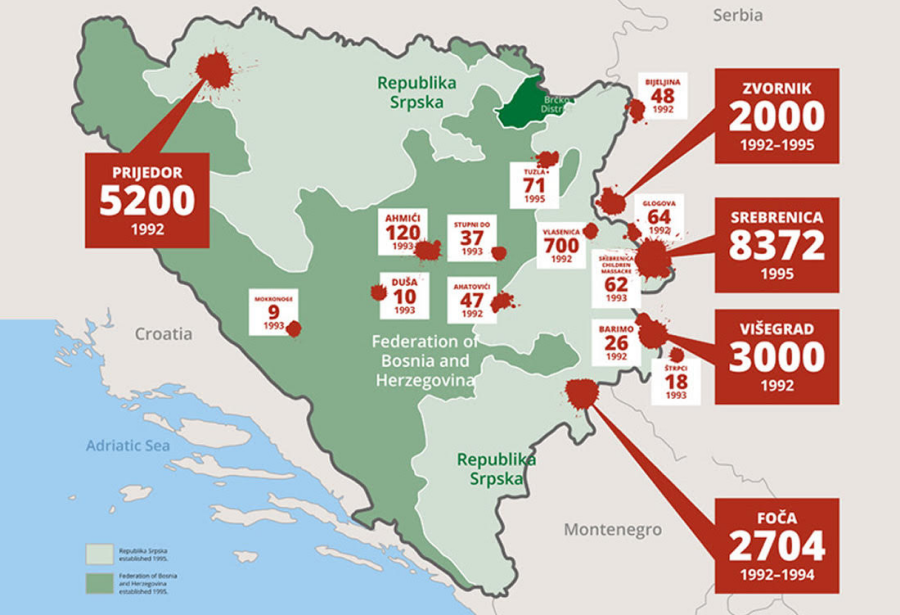
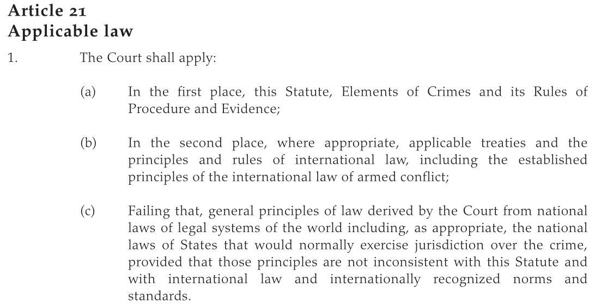

## Today's Agenda {background-image="./Images/background-scales_justice_v3.png" .center}

```{r}
# background-size="1920px 1080px"
library(tidyverse)
library(readxl)
```

<br>

**Section 2: How effective have international institutions been in reducing the use of torture by governments around the world?**

- The International Criminal Court (ICC) and the Rome Statute (1998)

<br>

::: r-stack
Justin Leinaweaver (Fall 2026)
:::

::: notes

**Prep for Class**

1. Check Canvas submissions

2. Prep tracking document for analyzing the ICC / Rome Statute

3. Readings

    - [The Rome Statute (1998)](https://www.icc-cpi.int/sites/default/files/RS-Eng.pdf)
    
    - ["Understanding the International Criminal Court"](https://www.icc-cpi.int/sites/default/files/Publications/understanding-the-icc.pdf)
    
    - [UNTC Page](https://treaties.un.org/Pages/ViewDetails.aspx?src=IND&mtdsg_no=XVIII-10&chapter=18&clang=_en)

<br>

**SLIDE**: Our current place in the Section 2 research project

:::


## {background-image="./Images/background-scales_justice_v3.png" .center}

**How effective have international institutions been in reducing the use of torture by governments around the world?**

- [Week 6: Defining and Measuring the Outcome]{style="color:gray;"}

- [Week 7: The Convention Against Torture (CAT)]{style="color:gray;"}

- [Week 8: Explaining the Effect of the CAT on Torture]{style="color:gray;"}

- **Week 9: The International Criminal Court (ICC)**

- [Week 10: Can the ICC help us reduce global torture?]{style="color:gray;"}

- [Week 11: Case Studies of ICC Effectiveness]{style="color:gray;"}

::: notes

This week we are introducing our second international institution designed to reduce human rights violations around the world

- On Monday we prepped for this by digging into IO case studies and principal-agent theory

<br>

My argument to you last class was that PA theory adds to our understanding beyond what we get with legalization and the rational design conjectures

- Specifically, PA theory gives us a better answer to the question, why would states choose to delegate significant authority to an international institution?

<br>

Before we dig into the ICC, let's quickly recap the four reasons PA theory answers the question with, of course states should consider delegation!

<br>

**According to PA theory, what is the first big reason states are willing to delegate significant authorities to an IO?**

- (**SLIDE**: Delegation is limited)

:::


## {background-image="./Images/background-scales_justice_v3.png" .center}

::: {.r-fit-text}
**Principal-Agent Theory (Hawkins, Lake, Nielson & Tierney 2006)**
:::

<br>

"Delegation is a conditional grant of authority from a principal to an agent that empowers the latter to act on behalf of the former" (4).

- Always governed by a contract

- Limited in time or scope

- Must be revocable

- Roles are mutually constitutive

::: notes

Reason 1: Because delegation is limited and controlled BY DEFINITION!

- Properly conceived and designed, delegation is conditional and not to be feared

- If the proper model for understanding an IO is an employer-employee relationship then states probably shouldn't fear IOs quite so much!

<br>

**According to PA theory, what is the second reason states are willing to delegate significant authorities to an IO?**

- (**SLIDE**: Reason 2 - Because delegation can provide substantial benefits)

:::


## {background-image="./Images/background-scales_justice_v3.png" .center .smaller}

::: {.r-fit-text}
**Principal-Agent Theory (Hawkins, Lake, Nielson & Tierney 2006)**
:::

<br>

:::: {.columns}
::: {.column width="50%"}

**Benefits of Delegation**

1. Divide the labor & create gains from specialization

2. Managing policy externalities

3. Facilitating collective decision-making

4. Resolving disputes

5. Enhancing credibility

6. Creating policy bias

:::

::: {.column width="50%"}

::: {.fragment}

**Control Mechanisms**

1. Rules vs Discretion

2. Monitoring and Reporting Requirements

3. Screening and Selection Procedures

4. Institutional Checks and Balances

5. Sanctions

:::
:::
::::

::: notes

Reason 2: Because delegation can provide substantial benefits

<br>

**Based on our case studies last class, how significant are these benefits to states in the real world?**

<br>

**According to PA theory, what is the third reason states are willing to delegate significant authorities to an IO?**

- (**REVEAL**: Reason 3 - Because delegation can be designed to minimize agency slack)

<br>

**Based on our case studies last class, how difficult is it to limit agency slack in IOs in the real world?**

- (Not hard! There are a TON of different control mechanisms available that can allow states to steer their agents in productive ways)

<br>

**According to PA theory, what is the final reason states are willing to delegate significant authorities to an IO?**

- (**SLIDE**: Reason 4: BECAUSE choosing NOT to delegate ALSO carries costs!)

:::


## {background-image="./Images/background-scales_justice_v3.png" .center}

::: {.r-fit-text}
**Why would states delegate power to an external agent?**
:::

<br>

::: {.r-fit-text}
**Principal-Agent Theory (Hawkins, Lake, Nielson & Tierney 2006)**
:::

{style="display: block; margin: 0 auto"}

::: notes

Reason 4: BECAUSE choosing NOT to delegate ALSO carries costs!

- The choice is not delegation vs the problem is solved otherwise

- The choice is:

    1. do nothing (and the problem remains)
    
    2. Try to solve it with domestic enforcement (fingers crossed), OR
    
    3. Try to solve it with delegation

- Without considering the "next best alternative" it can be hard to understand the delegation choice!

<br>

**Any questions on our work on PA theory before we dig into the ICC?**

<br>

**SLIDE**: Ok, let's talk about the ICC in the big picture

:::


## {background-image="./Images/07_2-ICC_v3.png" .center}

::: {.r-fit-text}
**Rome Statute of the International Criminal Court (1998)**
:::

<br>

### What are your takeaways from the preamble to the treaty?

::: notes

**If the preamble represents the normative argument in favor of an institution, what do we learn about the need for an international criminal court?**

<br>

(**SLIDE**: For me?)

:::


## {background-image="./Images/07_2-ICC_v3.png" .center}

::: {.r-fit-text}
**Rome Statute of the International Criminal Court (1998)**
:::

<br>

- "**Mindful** that during this century millions of children, women and men have been victims of unimaginable atrocities that deeply shock the conscience of humanity,

- **Recognizing** that such grave crimes threaten the peace, security and well-being of the world, ...

- **Emphasizing** in this connection that nothing in this Statute shall be taken as authorizing any State Party to intervene in an armed conflict or in the internal affairs of any State" (preamble).

::: notes

The cognitive dissonance required to make international law is sometimes staggering

<br>

**SLIDE**: To Part 1

:::


## {background-image="./Images/07_2-ICC_v3.png" .center}

**Rome Statute of the International Criminal Court (1998)**

<br>

**Article 1: The Court**

An International Criminal Court (‘the Court’) is hereby established. It shall be a permanent institution and shall have the power to exercise its jurisdiction over persons for the most serious crimes of international concern, as referred to in this Statute, and shall be complementary to national criminal jurisdictions. The jurisdiction and functioning of the Court shall be governed by the provisions of this Statute.

::: notes

Let's start in big picture terms with Article 1 of the treaty.

- We'll use this as a jumping off point for discussing the Court primarily as it is discussed in the first three sections of the reading

- "The ICC at a glance", "The structure of the ICC" and "Crimes within the jurisdiction of the ICC"

<br>

This article contains a ton of important detail about the need for and the design of the court.

:::


## {background-image="./Images/07_2-ICC_v3.png" .center}

**Rome Statute of the International Criminal Court (1998)**

<br>

**Article 1: The Court**

An International Criminal Court (‘the Court’) is hereby established. It shall be a [**permanent institution**]{style="color:blue;"} and shall have the power to exercise its jurisdiction over persons for the most serious crimes of international concern, as referred to in this Statute, and shall be complementary to national criminal jurisdictions. The jurisdiction and functioning of the Court shall be governed by the provisions of this Statute.

::: notes

**Why does Article 1 invoke the language of a "permanent institution"?**

- **Why was this needed?**

- (**SLIDE**)

:::


## {background-image="./Images/background-scales_justice_v3.png" .center}

:::: {.columns}
::: {.column width="50%"}



:::

::: {.column width="50%"}


:::
::::

::: notes

In the modern era, but before the ICC, the world was confronted with two atrocities that inspired outrage similar to that following WWII.

- In both Yugoslavia and Rwanda in the early 1990s: Genocide, war crimes and crimes against humanity

<br>

The problem was that no one at the international level had the clear authority to do anything about either case

- Both were domestic actions happening within a single state's sovereign borders

<br>

The UN Security Council, which is charged with maintaining international peace and order, eventually created ad hoc tribunals to investigate and punish criminal acts in each case

- SC resolution 827 in 1993 created the International Criminal Tribunal for the former Yugolsavia (ICTY)

- SC resolution 955 in 1994 created the International Criminal Tribunal for Rwanda (ICTR).

<br>

The creation of these tribunals, especially ICTY, led to considerable international criticism.

**BRAINSTORM: Why might a state, an NGO or an IO have a problem with this ad hoc approach by the SC?**

1. (**Inconsistency**) 

    - Not every atrocity gets its own tribunal. 

    - If justice is inconsistent then it is less likely to influence the calculations of "bad" leaders
    
2. (**Selective justice**)

    - Aren't these just examples of "justice" by the victors?
    
    - Powerful states disagree with some actions by weaker states so they are punished as "crimes"

3. (**Distraction**)

    - Transparent cover for failure by the major powers to stop the crimes themselves

4. (**Lack legitimacy**)

    - What right does the SC have to create international courts? None specified in Charter.
    
:::


## {background-image="./Images/07_2-ICC_v3.png" .center}

**Rome Statute of the International Criminal Court (1998)**

<br>

**Article 1: The Court**

An International Criminal Court (‘the Court’) is hereby established. It shall be a [**permanent institution**]{style="color:blue;"} and shall have the power to exercise its jurisdiction over persons for the most serious crimes of international concern, as referred to in this Statute, and shall be complementary to national criminal jurisdictions. The jurisdiction and functioning of the Court shall be governed by the provisions of this Statute.

::: notes

The ICC was designed to be a "permanent institution" in order to address these concerns

- The ICC provides a consistency of application, plus

- An equality of protection, plus

- It is rooted in legitimate international authority.

<br>
    
All combined to, hopefully, push leaders to make "better" decisions

:::


## {background-image="./Images/background-scales_justice_v3.png" .center}

::: {.r-fit-text}
**Principal-Agent Theory (Hawkins, Lake, Nielson & Tierney 2006)**
:::

<br>

"Delegation is a conditional grant of authority from a principal to an agent that empowers the latter to act on behalf of the former" (4).

- Always governed by a contract

- [**Limited in time or scope**]{style="color:blue;"}

- [**Must be revocable**]{style="color:blue;"}

- Roles are mutually constitutive

::: notes

**How do we understand the creation of a "permanent institution" using the definition of "delegation" from PA Theory?**

- **Doesn't this conflict with the second and third conditions here?**

<br>

**Revocable?**

- Since each "principal", e.g. state party to the treaty, has the option to withdraw from the Rome Statute they maintain the "revocable" condition of the relationship.

**Limited?**

- I think you'll see that a number of limitations on both time and scope remain despite the ICC being "permanent".

:::


## {background-image="./Images/07_2-ICC_v3.png" .center}

**Rome Statute of the International Criminal Court (1998)**

<br>

**Article 1: The Court**

An International Criminal Court (‘the Court’) is hereby established. It shall be a permanent institution and shall have the power to exercise its [**jurisdiction over persons**]{style="color:blue;"} for the most serious crimes of international concern, as referred to in this Statute, and shall be complementary to national criminal jurisdictions. The jurisdiction and functioning of the Court shall be governed by the provisions of this Statute.

::: notes

A second important characteristic of the ICC illustrated by Article 1 is its specification of "jurisdiction over persons." 

<br>

**Given everything we've studied this semester about international law, why is this a big deal?**

<br>

Novel innovation in 20th century international law to directly connect individuals to an international institution.

- Previously an indirect connection; states agree rules between themselves and then implement them domestically to impact individuals.

<br>

Pushes international law in some very intriguing directions

1. Establishes the idea that you, as an individual, are deserving of international protection even if that means limiting the soverign authority of your state

2. Establishes the idea that you, as an individual, are responsible for your actions and the actions of those who report to you.

<br>

Many states, especially the US, have viewed this as a massive threat to their  sovereignty.

- Proposes a set of societal rules and individual rights that are hierarchically superior to your domestic laws, and

- Puts in the heads of your citizens that they must think for themselves BEFORE following your orders

- What leader wants to run a system where you don’t make all the rules and your subordinates don’t have to follow your commands?

:::


## {background-image="./Images/07_2-ICC_v3.png" .center}

**Rome Statute of the International Criminal Court (1998)**

<br>

**Article 1: The Court**

An International Criminal Court (‘the Court’) is hereby established. It shall be a permanent institution and shall have the power to exercise its jurisdiction over persons for [**the most serious crimes of international concern**]{style="color:blue;"}, as referred to in this Statute, and shall be complementary to national criminal jurisdictions. The jurisdiction and functioning of the Court shall be governed by the provisions of this Statute.

::: notes

A third important characteristic of the ICC illustrated by Article 1 is its specification of a somewhat limited subject jurisdiction.

<br>

**Per the reading, which crimes fall within the jurisdiction of the ICC?**

- Note that this is covered in the treaty itself in Arts 5-8

    - (a. the crime of genocide)

    - (b. crimes against humanity)

    - (c. War crimes)

    - (d. the crime of aggression)

<br>

We can think of this as another important attempt by the principals to narrow the scope of the new agent.

:::


## {background-image="./Images/07_2-ICC_v3.png" .center}

**Rome Statute of the International Criminal Court (1998)**

<br>

**Article 1: The Court**

An International Criminal Court (‘the Court’) is hereby established. It shall be a permanent institution and shall have the power to exercise its jurisdiction over persons for the most serious crimes of international concern, as referred to in this Statute, and shall be [**complementary to national criminal jurisdictions**]{style="color:blue;"}. The jurisdiction and functioning of the Court shall be governed by the provisions of this Statute.

::: notes

A fourth important characteristic of the ICC illustrated by Article 1 is its requirement that the court be "complementary to national criminal jurisdictions."

**Per the reading, what does this mean?**

- (Article 17: National courts have priority over the ICC unless “unwilling or unable genuinely to carry out the investigation or prosecution...”)

<br>

**If you are a state trying to decide whether to join the ICC, would you be fully comforted by the "complementarity" principal or not?**

- (Could be a bigger infringement than you realized if the ICC gets to decide “genuine” effort)

- (Almost ANYTHING could be their jurisdiction)

<br>

**Ok, putting all this together, when does the ICC have jurisdiction over a case?**

1. Person alleged to have committed crime in Art 5

2. Must be citizen of ICC party state or have committed crime in ICC party state

3. Domestic courts must fail to “genuinely” investigate or prosecute.

:::


## {background-image="./Images/07_2-ICC.webp" .center}

{style="display: block; margin: 0 auto"}

::: notes

One other set-up idea comes from Article 21 of the Rome Statute governing how the ICC judges are supposed to adjudicate their cases.

**How does this compare to the ICJ article 38 we have so frequently discussed this semester?**

<br>

**Why the differing focus here on primarily the Rome Statute?**

- (Not about state vs state conflicts with a wide range of scopes; this is narrowly about individual offenses as defined primarily by this treaty)

<br>

**SLIDE**: Ok, let's talk benefits!

<br>

**Notes**

ICJ Article 38

1. The Court, whose function is to decide in accordance with international law such disputes as are submitted to it, shall apply:
    - international conventions, whether general or particular, establishing rules expressly recognized by the contesting states;
    - international custom, as evidence of a general practice accepted as law;
    - the general principles of law recognized by civilized nations;
    - subject to the provisions of Article 59, judicial decisions and the teachings of the most highly qualified publicists of the various nations, as subsidiary means for the determination of rules of law.
    
2. This provision shall not prejudice the power of the Court to decide a case ex aequo et bono, if the parties agree thereto.

:::


## {background-image="./Images/background-scales_justice_v3.png" .center .smaller}

:::: {.columns}
::: {.column width="65%"}
**Rome Statute (1998)**

1. Establishment of the Court
2. Jurisdiction, admissibility & applicable law
3. General principles of criminal law
4. Composition & administration of the Court
5. Investigation & prosecution
6. The trial
7. Penalties
8. Appeal & revision
9. International cooperation & judicial assistance
10. Enforcement
11. Assembly of States Parties
12. Financing
13. Final clauses
:::

::: {.column width="35%"}
**Benefits of Delegation**

1. Divide the labor & create gains from specialization

2. Managing policy externalities

3. Facilitating collective decision-making

4. Resolving disputes

5. Enhancing credibility

6. Creating policy bias
:::
::::

::: notes

For today each of you identified three benefits of delegation across different parts of the Rome Statute

- Let's share what you found, but organized by benefit

- *TRACK on the BOARD*

<br>

**Ok, who has examples from the Rome Statute of the ICC dividing the labor and creating gains from specialization?**

- *SHARE and DISCUSS*

<br>

*REPEAT for EACH benefit, list articles*

<br>

**Ultimately, how substantial are the benefits of delegation in the Rome Statute?**

<br>

**SLIDE**: Now let's do the control mechanisms

:::


## {background-image="./Images/background-scales_justice_v3.png" .center .smaller}

:::: {.columns}
::: {.column width="65%"}
**Rome Statute (1998)**

1. Establishment of the Court
2. Jurisdiction, admissibility & applicable law
3. General principles of criminal law
4. Composition & administration of the Court
5. Investigation & prosecution
6. The trial
7. Penalties
8. Appeal & revision
9. International cooperation & judicial assistance
10. Enforcement
11. Assembly of States Parties
12. Financing
13. Final clauses
:::

::: {.column width="35%"}
**Control Mechanisms**

1. Rules vs Discretion

2. Monitoring and Reporting Requirements

3. Screening and Selection Procedures

4. Institutional Checks and Balances

5. Sanctions
:::
::::

::: notes

For today each of you also identified three control mechanisms across different parts of the Rome Statute

- Let's share what you found, but organized by mechanism

- *TRACK on the BOARD*

<br>

**Ok, who has examples from the Rome Statute of the rules vs discretion in the ICC?**

- *SHARE and DISCUSS*

<br>

*REPEAT for EACH mechanism, list articles*

<br>

**Ultimately, how good a job did the designers do in minimizing agency slack?**

<br>

**If time remains, why do we think the United States is such a vigorous opponent of the institution?**

<br>

**SLIDE**: Next week, academic research on the ICC

:::


## For Next Class {background-image="./Images/background-scales_justice_v3.png" .center}

<br>

Hillebrecht, C. (2016). The Deterrent Effects of the International Criminal Court: Evidence from Libya. *International Interactions*, 42(4), 616–643. 

::: notes

Canvas ASSIGNMENT: Unpacking Hillebrecht's (2016) argument and analyses

Be ready to discuss the Hillebrecht article in class. To help you prepare for our discussion read the article and answer the following prompts:

1. What is the RQ?
2. On what specific page numbers does Hillebrecht explain the central argument in the paper? (e.g. the proposed answer to the RQ)
3. Big picture, what is the proposed answer to the question?
4. On what specific page numbers does Hillebrecht explain and evaluate the sources of the data being analyzed?
5. On what specific page numbers does Hillebrecht describe and explain the tests of the data?
6. What is the bottom line conclusion of the paper? What does Hillebrecht think we know about the world now that we didn't before?


:::