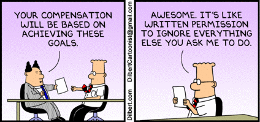
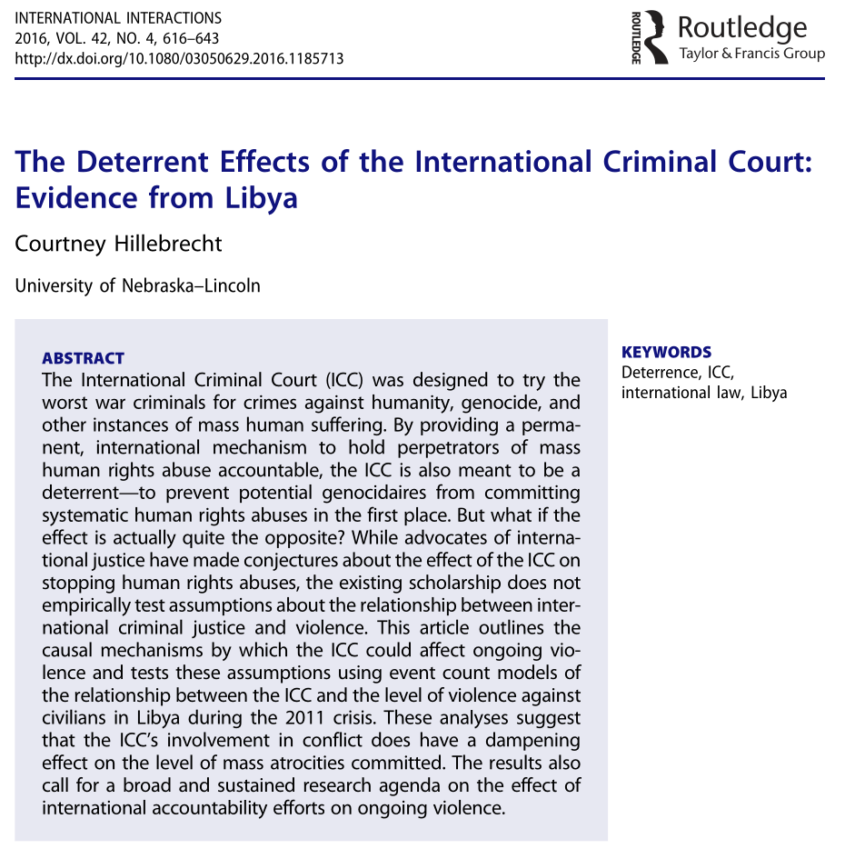
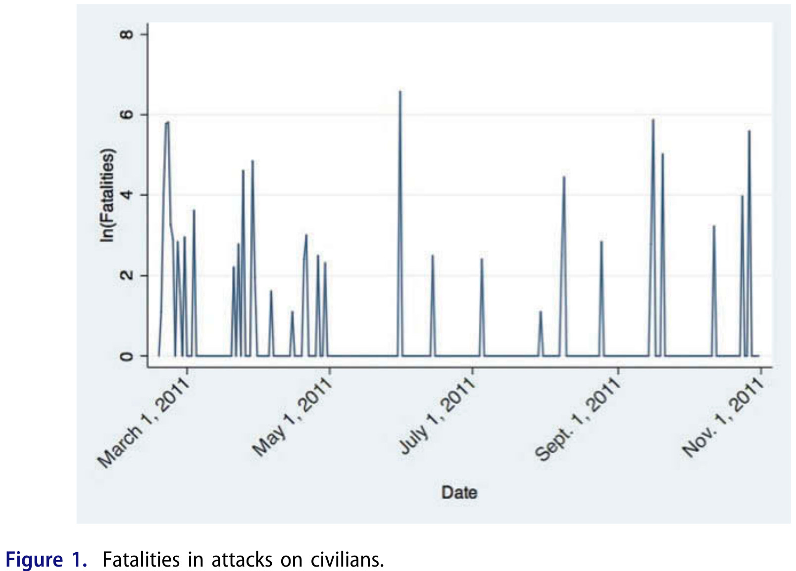
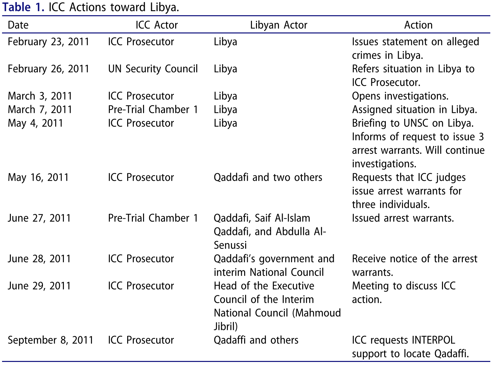
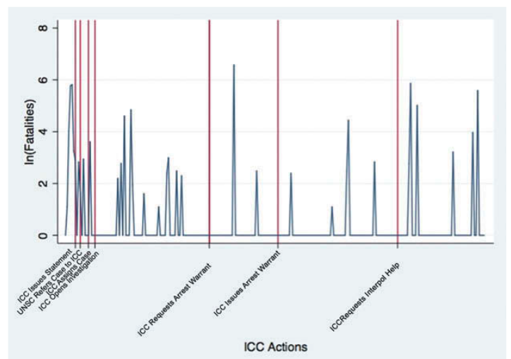
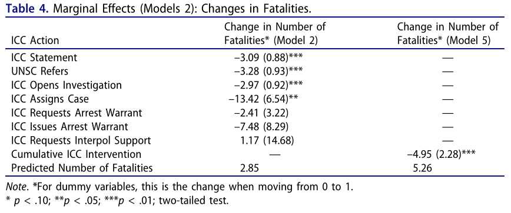

## Today's Agenda {background-image="./Images/background-scales_justice_v3.png" .center}

```{r}
# background-size="1920px 1080px"
library(tidyverse)
library(readxl)
```

<br>

**Section 2: How effective have international institutions been in reducing the use of torture by governments around the world?**

- Hillebrecht, C. (2016). The Deterrent Effects of the International Criminal Court: Evidence from Libya. *International Interactions*, 42(4), 616–643. 

<br>

::: r-stack
Justin Leinaweaver (Fall 2026)
:::

::: notes

**Prep for Class**

1. Review Canvas submissions

2. Markers x 3

<br>

**SLIDE**: The recap

:::


## {background-image="./Images/background-scales_justice_v3.png" .center}

**How effective have international institutions been in reducing the use of torture by governments around the world?**

- Week 6: Defining and Measuring the Outcome

- Week 7: The Convention Against Torture (CAT)

- Week 8: Explaining the Effect of the CAT on Torture

- Week 9: The International Criminal Court (ICC)

- Week 10: Can the ICC help us reduce global torture?

- Week 11: Case Studies of ICC Effectiveness

::: notes

Section 2 of our class has focused on a big question

- Have international institutions made a significant and positive impact on torture rates around the world?

- Based on the data we explored, we have clearly shown that torture is a serious and important problem around the world so this question needs an answer!

<br>

**SLIDE**: Recap 2

:::


## {background-image="./Images/background-scales_justice_v3.png" .center}

**How effective have international institutions been in reducing the use of torture by governments around the world?**

- [Week 6: Defining and Measuring the Outcome]{style="color:gray;"}

- **Week 7: The Convention Against Torture (CAT)**

- **Week 8: Explaining the Effect of the CAT on Torture**

- [Week 9: The International Criminal Court (ICC)]{style="color:gray;"}

- [Week 10: Can the ICC help us reduce global torture?]{style="color:gray;"}

- [Week 11: Case Studies of ICC Effectiveness]{style="color:gray;"}

::: notes

Our first attempt to answer this question focused on the impacts of the Convention Against Torture (1984)

- We analyzed the design of the treaty,

- We reviewed some of the published research on the topic, and

- We replicated and extended the data analyses with current V-Dem data

<br>

**All of that said, are we comfortable claiming the CAT has reduced the use of torture around the world?**

<br>

Maybe?

- I am persuaded that treaty effectiveness is the result of a complicated interaction between treaty design, domestic enforcement and international pressure

- This means the impact of the CAT has varied, and will always vary, across time and state

- So long as domestic and international groups are willing to make it an issue, the CAT serves as a touchstone for changing behavior!

- BUT, it appears to also have allowed some VERY bad states to endure and that really sucks...

<br>

Last week we then shifted to our second test of this research question

- Has the ICC reduced the use of torture?

<br>

**SLIDE**: Let's do a quick recap on our setup work

:::


## {background-image="./Images/background-scales_justice_v3.png" .center}

::: {.r-fit-text}
**Principal-Agent Theory (Hawkins, Lake, Nielson & Tierney 2006)**
:::

{style="display: block; margin: 0 auto"}

::: notes

Last week we reviewed some of the key insights of principal-agent theory when applied to states and international organizations

<br>

Specifically, I made the argument to you that there are four solid reasons states should be willing to delegate significant authority to an IO

- **Refresh my memory, what are those reasons?**

1. (Reason 1: Because delegation is limited and controlled BY DEFINITION!)

2. (Reason 2: Because delegation can provide substantial benefits)

3. (Reason 3: Because delegation can be designed to minimize agency slack)

4. (Reason 4: BECAUSE choosing NOT to delegate ALSO carries costs!)

<br>

That last one is such a key idea

- All policy choices create costs for states

- Delegation is costly, but so is doing nothing and so is cooperating in the absence of delegation!

<br>

**SLIDE**: Applied to the ICC

:::


## The International Criminal Court (ICC) {background-image="./Images/background-scales_justice_v3.png" .center}

<br>

**Benefits of Delegation**

1. Divide the labor & create gains from specialization

2. Managing policy externalities

3. Facilitating collective decision-making

4. Resolving disputes

5. Enhancing credibility

::: notes

**Give me some examples of how the ICC provides specific benefits of delegation in line with PA theory**

<br>

**SLIDE**: Control mechanisms

<br>

*Parts of the Rome Statute (1998)*

1. Establishment of the Court
2. Jurisdiction, admissibility & applicable law
3. General principles of criminal law
4. Composition & administration of the Court
5. Investigation & prosecution
6. The trial
7. Penalties
8. Appeal & revision
9. International cooperation & judicial assistance
10. Enforcement
11. Assembly of States Parties
12. Financing
13. Final clauses

:::


## The International Criminal Court (ICC) {background-image="./Images/background-scales_justice_v3.png" .center}

<br>

**Control Mechanisms**

1. Rules vs Discretion

2. Monitoring and Reporting Requirements

3. Screening and Selection Procedures

4. Institutional Checks and Balances

5. Sanctions

::: notes

**Give me some examples of how the Rome Statute includes specific control mechanisms**

<br>

**SLIDE**: Ok, let's dig into our first research article on the ICC

<br>

*Parts of the Rome Statute (1998)*

1. Establishment of the Court
2. Jurisdiction, admissibility & applicable law
3. General principles of criminal law
4. Composition & administration of the Court
5. Investigation & prosecution
6. The trial
7. Penalties
8. Appeal & revision
9. International cooperation & judicial assistance
10. Enforcement
11. Assembly of States Parties
12. Financing
13. Final clauses

:::


## {background-image="./Images/background-scales_justice_v3.png" .center}

{style="display: block; margin: 0 auto"}

::: notes

**What is the RQ in Hillebrecht's (2016) article?**

- (My versions)

- (Does the International Criminal Court improve respect for human rights in conflict zones?)

- (What is the impact of the ICC on human rights in conflict zones?)

<br>

**How and why does Hillebrecht present this as a puzzle to be explained?**

1. ("Empirical research on the effects of the ICC during ongoing conflict, however, is limited" (617).)

2. ("The international community provides a great deal of political and financial support (to the tune of US$166 million in 2014) to the ICC")

3. ("Worst of all, however, what if the ICC has a perverse effect on the protection of human rights? If perpetrators of human rights abuse expect that they will be held accountable tomorrow, will they fight harder and dirtier today?")

<br>

At the bottom of p618 and the top of p619, Hillebrecht summarizes the ICC

- **Given our work on the design of the institution last week, would you say this is a good summary? Leaving anything important out?**

<br>

**SLIDE**: Let's talk about the ICC and Libya

:::


## {background-image="./Images/background-scales_justice_v3.png"}

::: {.r-fit-text}
**The International Criminal Court and the Crisis in Libya**
:::

{.absolute left=0 bottom=150 width="500"}

{.absolute right=0 bottom=150 width="500"}

::: notes

*Note: Figure 1 present natural log of fatalities*

<br>

Hillebrecht chooses to answer this important research question by focusing in on a single case: The ICC's actions in Libya

<br>

**Why does Hillebrecht suggest this is a good empirical case for answering the research question?**

<br>

Hillebrecht argues good case because:

- ICC action initiated at the behest of the Security Council

- Accompanied by NATO-led military action against Qaddafi

- reflect the intended role of the ICC as one part of a larger international and domestic legal and political architecture meant to limit and deter atrocity crimes

<br>

**Any concerns with generalizing from this case when trying to answer a much broader question about the impacts of the ICC on human rights violations?**

- "The ICC’s involvement in Libya is unique..." seems like a problem, no?

    - Of the other eight ICC situations, only Darfur was prompted by a UNSC referral
    
    - Libya is also the only of the ICC’s situations in which significant international military intervention was contemporaneous to the ICC’s investigations and indictments
    
    - it is important to take into account the potentially confounding effects of NATO’s military action and the UNSC’s referral

<br>

**SLIDE**: Alright, let's explore the model

<br>

*Notes*

- The Office of the Prosecutor (OTP) "was very proactive in issuing early and loud calls for accountability for atrocity crimes and violations of international humanitarian law in Libya" (619).

- "The UN and the ICC became involved almost immediately" (620)

    - Conflict begins "February 17, 2011, when thousands of protestors took to the streets" and quickly leads to armed standoff between the rebeles and the government
    
    - "The OTP issued a statement about the alleged crimes in Libya on February 23, 2011."
    
- "The deterioration of human rights conditions in Libya was readily apparent."

- ICC took an active interest in the violence

- "The ICC’s involvement in Libya is unique because it was initiated at the behest of the Security Council and accompanied by NATO-led military action against Qaddafi. Of the other eight ICC situations, only Darfur was prompted by a UNSC referral. Libya is also the only of the ICC’s situations in which significant international military intervention was contemporaneous to the ICC’s investigations and indictments. These features set Libya apart from the other situations at this tribunal, but they also reflect the intended role of the ICC as one part of a larger international and domestic legal and political architecture meant to limit and deter atrocity crimes. For the present purposes—an early empirical analysis of the ICC’s impact on ongoing conflict—Libya provides an important test case. If the ICC were to have a deterrent effect on ongoing conflict, we would expect it to be in a situation in which the Court works with other actors. Of course, given the ICC’s imbrication in the international community’s efforts in Libya, it is important to take into account the potentially confounding effects of NATO’s military action and the UNSC’s referral, which the following models do, and to interpret the results of the analysis with the unique characteristics of Libya in mind." (622).

:::


## Hillebrecht (2016): The Model {background-image="./Images/background-scales_justice_v3.png" .center}

<br>

**Interests**

- ?

**Institutions**

- ?

**Interactions**

- ?

::: notes

Before class I asked each of you to take a stab at this diagram

- So, let's start by working in pairs

- Show your diagram to the person next to you, see if you were both on the same proverbial page or not

<br>

*Split class into three groups*

- GROUPS, get a consensus diagram of the model on the board!

- Go!

<br>

*PRESENT and DISCUSS each*

<br>

**SLIDE**: My version

<br>

*NOTES*

The deterrent effects of the International Criminal Court during wartime (623-626)

- Historically, "suspected war criminals and human rights perpetrators enjoyed a great deal of impunity"

- International and domestic courts have begun to ramp up attention on these crimes moving the question to: "whether or not the increased likelihood and threat of prosecution is a sufficient deterrent against the commission of atrocity crimes."

Premise 1: Deterrence of human rights abuses depends on "the likelihood of accountability, rather than the severity of the punishment" (624)

- The first chunk of this section (623-624 before "With those caveats in place") is an argument to support the first premise here.
- Hillebrecht is trying to convince you that deterrence comes from the likelihood of accountability NOT punishment
- In other words, even if the ICC is hampered in a million ways from getting its hands on you it can still change your behavior.
- The threat of prosecution for human rights violations has been increasing across time (at both domestic and international levels)
- Each prosecution of a human rights abuser sets an important precedent that no one is above the law (rule of law) and human rights law will be enforced
- "the domestic criminal justice literature has found increasing support for the deterrent effect of criminal accountability"

Premise 2: The likelihood of accountability depends on "the willingness and ability of domestic and international actors to turn suspected war criminals over to the ICC" (624)

- "the number of states willing to host wanted war criminals is shrinking"
- "Moreover, transfer to The Hague might be preferable to facing punishment at home, as Qaddafi’s own death later went on to show."
- States must show they are willing to allow their own citizens to be prosecuted
- States must also not shield "allies and trading partners"

Premise 3: The likelihood of accountability depends on the international community providing "the political and financial capital needed to initiate, investigate, and try cases at the ICC" (625).

Premise 4: The likelihood of accountability depends on the ICC making "it clear that investigations and trials will take place in a timely manner" (625).

- Only three judgements so far (2016), it is picking up the pace more recently

Therefore, "Action at the ICC will lead to a decrease in the violence committed during a conflict, particularly government-sponsored killing of civilians" (626).

:::


## Hillebrecht (2016): The Model {background-image="./Images/background-scales_justice_v3.png" .center .smaller}

<br>

**Interests**

- Leaders fighting for political survival (during wartime)

**Institutions**

- No (or minimal) domestic legal constraints on using repression or committing atrocities

- The ICC provides a framework for accountability at the international level

**Interactions**

- The ICC's deterrent effect on repression or atrocities increases as:

    1. A leader's options for asylum decrease (domestic or international),
    2. The ICC receives support from powerful states or the leader's allies  (political & financial capital),
    3. The ICC makes clear the trial will happen more quickly

::: notes

**Ok, what do you think? Am I missing anything you'd like to add?**

<br>

**Is this a logical model? Why or why not?**

<br>

**SLIDE**: Let's take a look at Hillebrecht's analyses

:::


## {background-image="./Images/background-scales_justice_v3.png" .center}

::: {.r-fit-text}
**Hillebrecht (2016): Data Sources & Measurements**
:::

<br>

**Outcome Variables**

- The number of government-sponsored fatalities accumulated per day (Armed Conflict Location and Event Dataset, ACLED)

::: {.fragment}
**Predictor Variables**

1. ICC Actions in Libya
    - 7 separate dummies
    
2. ICC Actions (cumulative)
:::
::: notes

Everybody turn p628 and let's talk about the outcome variable

- **Get ready to report back, is this a valid and reliable measure of atrocities? Why or why not?**

- *REPORT back and DISCUSS*

- "ACLED uses source materials from local, regional, national, and continental news media, NGO reports, and Africa-focused news reports" 628.

- "This means that while the victims could be considered combatants in other contexts, in these events they are noncombatants. The ACLED data are conservative in their counting for fatalities and only include numbers of fatalities when explicitly reported by their source materials. When sources conflict, ACLED uses the lower count."

- Footnote 10: "The ACLED data are conservative in their counting of civilian casualties, but this does not imply that it is a biased undercount. Rather, the ACLED data triangulate accounts of civilian deaths from a number of sources, thereby mitigating potential over- or undercounting biases that might result from only relying on major newspapers or local NGOs. The fact that ACLED is conservative in its counting of civilian casualities should make it even more likely to see an effect of the ICC on lowering the civilian casualty count" (628).

- ACLED also includes data on whether the perpetrator was a government agent or rebel (630).

<br>

**REVEAL**: GROUPS, review the details of the predictor variable measurement

- **Get ready to report back, is this a valid and reliable measure of "threat" by the ICC? Why or why not?**

- *REPORT back and DISCUSS*

<br>

- "(1) when the ICC issued a statement regarding the potential crimes against humanity in Libya, (2) when the UN Security Council referred the case to the ICC, (3) when the ICC opened the investigation, (4) when the ICC assigned the case to a chamber, (5) when the ICC requested that the chamber issue arrest warrants, (6) when the ICC issued the warrants, and (7) when the ICC asked INTERPOL for help with the arrests." (629) 

- OMITS: news briefing and "Libya’s receipt of the arrest warrants and subsequent meeting about the arrest warrants in June 2011 due to the redundancy of those events with aforementioned actions"

- Cumulative: "This cumulative measure is predicated on the idea that each of the ICC’s actions builds on previous actions. The ICC’s actions are sequential and path dependent, meaning that the ICC cannot, for example, issue arrest warrants without first getting a referral.

<br>

**SLIDE**: Let's examine the analyses

:::


## Hillebrecht (2016): Analysis {background-image="./Images/background-scales_justice_v3.png" .center}

{style="display: block; margin: 0 auto"}

::: notes

Figure 2. ICC actions and fatalities in attacks against civilians.

- Libya case across time

- "Figure 2 provides an overview of ICC interventions and the daily number
of fatalities incurred during attacks on civilians with the ICC’s interventions
into the conflict."

- y-axis is in the log scale so 
    - ln(2) = 7 deaths
    - ln(4) = 54 deaths
    - ln(6) = 403 deaths

<br>

**Ok, how strong is the relationship between ICC threat and atrocities according to this figure?**

- Not gonna lie, this does not strike me as the easiest piece of supporting evidence to interpret.

:::


## Hillebrecht (2016): Analysis {background-image="./Images/background-scales_justice_v3.png" .center}

<br>

{style="display: block; margin: 0 auto"}

::: notes

Model 2 is a negative binomial regression

- Includes a 1 day lag (e.g. assumes threats take a day to impact atrocities)

- ICC actions all negative and significant!

<br>

**So, per Hillebrecht (2016), has the ICC been effective?**

- Yes (at least according to the Libya case)

- "The results of this analysis suggest that the ICC’s involvement in Libya had a negative and statistically significant effect on the number of fatalities. The results suggest that the ICC can, in fact, serve as a deterrent of violence against civilians, particularly government-sponsored civilian casualties, during ongoing conflict. When the ICC became involved in Libya, through issuing statements and arrest warrants, and all of its actions in between, actors on the ground took note and improved their human rights practices. It is important to stress that the ICC’s involvement did not stop violence against civilians in Libya but rather that it correlated to a decrease in the violence" (632).

<br>

**SLIDE**: Theory x Analyses

:::


## {background-image="./Images/background-scales_justice_v3.png" .center .smaller}

**Hillebrecht (2016): Interactions**

- The ICC's deterrent effect on repression or atrocities increases as:

    1. A leader's options for asylum decrease (domestic or international),
    2. The ICC receives support from powerful states or the leader's allies  (political & financial capital),
    3. The ICC makes clear the trial will happen more quickly

{style="display: block; margin: 0 auto"}

::: notes

**To what degree are we convinced that this statistical test is a test of this model?**

- **How well does this test reflect the causal logic of the model?**

<br>

I'm a little confused.

- As we've mapped out the theory it emphasizes background dynamics that are key to make the ICC work

- Doesn't that mean that a test needs to examine across different cases with variation in the background conditions?

- This feels like selecting on the dependent variable...

<br>

**SLIDE**: We need more research!

:::


## For Next Class {background-image="./Images/background-scales_justice_v3.png" .center}

<br>

Hillebrecht, C., & Straus, S. (2017). Who Pursues the Perpetrators? State Cooperation with the ICC. Human Rights Quarterly, 39(1), 162–188. 

::: notes

**Questions on the assignment?**

<br>

Canvas ASSIGNMENT: Unpacking Hillebrecht and Straus' (2016) argument and analyses

Be ready to discuss the article in class. To prepare for our discussion read the article and answer the following prompts:

1. What is the research question and how does the paper try to convince you that this question is important?
2. Diagram the model in the paper using the interests, institutions and interactions approach (use bullet points in complete sentences)
3. On what specific page numbers does the paper explain and evaluate the sources of the data being analyzed?
4. What is the bottom line conclusion of the paper? What does the author think we know about the world now that we didn't before?


:::